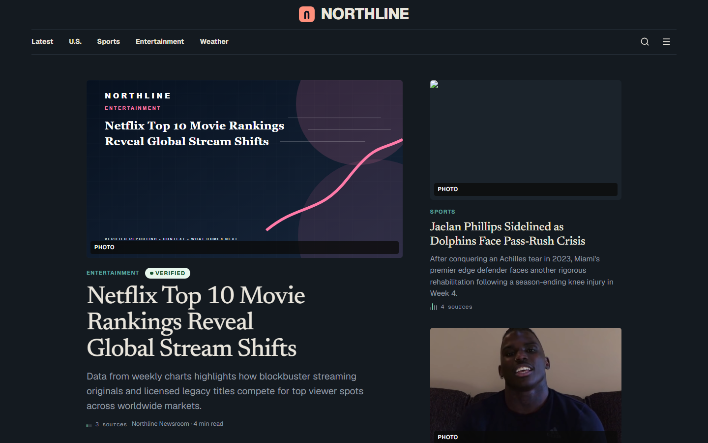
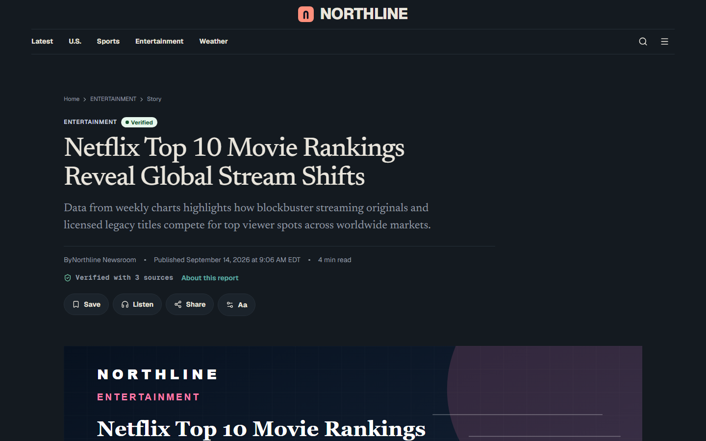
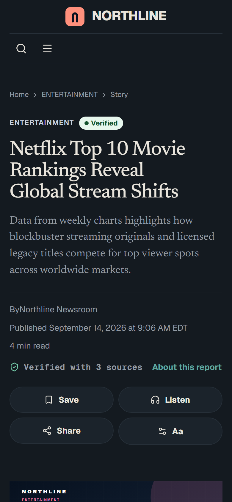
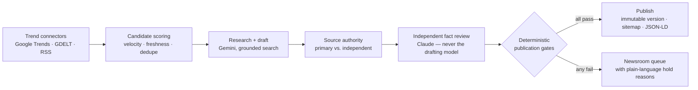

# Northline

**An autonomous U.S. news site that finds breaking stories, researches them, drafts them with AI, has a second model fact-check the draft, and publishes only what passes a set of evidence checks. It all runs as one Cloudflare Worker.**

[](../../actions/workflows/ci.yml)


Northline ran in production at `usnorthline.com`. It published about 130 articles with no staff writers. Every published story links to its sources and shows how well verified it is.

| Home | Article | Mobile |
| --- | --- | --- |
|  |  |  |

---

## What it does



1. **Discovery.** Every 15 minutes, connectors pull trending topics and news signals. Candidates are ranked by how many newsrooms are covering a story (source velocity) and how fresh it is, not by raw search volume. This keeps the pipeline writing about breaking news instead of old evergreen searches.
2. **Research and drafting.** A research-grounded model writes an original article. It has to meet a length target, include a currency rule, and cite every claim.
3. **Source authority.** Each cited domain is classified as a primary source (such as a government agency or the company in the story) or independent press. Spoofed domains are caught by checks on the domain and the subject of the story.
4. **Independent fact review.** A second provider reviews the claims. The pipeline will not let the drafting model review its own draft.
5. **Gates.** Publishing is decided by deterministic code, not by a model. A story needs enough primary and independent sources, few unsupported claims, recent events, a minimum quality score and a risk check. Politics, health and finance never publish on their own.
6. **Publishing.** Published article versions are frozen. Triggers in the D1 database stop anyone from rewriting a published version's text, media or source links. Corrections create new versions.

## Engineering highlights

- **Everything in one Worker.** vinext compiles the Next.js App Router into a single Cloudflare Worker. D1 is the database, R2 stores media and audio, Queues run background jobs, and Cron Triggers schedule the pipeline.
- **Jobs that survive failures.** Queue jobs are idempotent and use leases. Each job records why it stopped in an audit log, and each job has its own feature flag and kill switch. A capacity bug once counted failed runs against the daily limit and blocked retries for a whole day; the fix and a regression test are in the repo.
- **Guardrails in the database.** SQL triggers enforce publishing rules even if the app code has a bug. For example, an article can't go public without a timestamped frozen version.
- **Automatic data cleanup.** A daily job deletes expired AI request records, old failed runs and dead trends in small batches. After the `trends` table grew to 20k rows and hit D1's per-query CPU limit, this job plus two new indexes brought it back under.
- **Spending limits for AI.** There are daily and per-article budgets for AI and text-to-speech. Provider errors are logged with secrets redacted, and every model has a kill switch.
- **Security.** Staff sign in through Cloudflare Access. The app uses role-based permissions, CSRF protection, rate limits and SSRF protection on outbound requests. Fetched web pages and model output are treated as untrusted data, never as instructions.
- **SEO.** Pages include NewsArticle, BreadcrumbList, NewsMediaOrganization and Speakable structured data. The site has News and Image sitemaps, RSS, internal links and a Search Console integration.
- **Design.** "Provenance" is a dark-first editorial theme with a serif type scale. Each article card shows a small row of tick marks, one per source, with primary sources highlighted.
- **Optional article audio.** Articles can be narrated by a text-to-speech provider. The audio is stored in R2, deduplicated by content hash and capped by a budget.

## Tech stack

| Layer | Tools |
| --- | --- |
| App | Next.js 16 (App Router), React 19, TypeScript, Tailwind CSS 4 |
| Runtime | Cloudflare Workers via vinext, D1 (SQLite), R2, Queues, Cron Triggers, Access |
| Data | Drizzle ORM, 19 SQL migrations, Zod validation |
| AI | Google Gemini (research and drafting), Anthropic Claude (independent fact review) |
| Testing | Vitest (727 tests), Playwright, ESLint, `tsc --noEmit` |

## Repository layout

```
app/          Next.js routes: public site, protected newsroom, API endpoints
components/   UI for the public site and the newsroom
lib/
  editorial/  pipeline: candidate selection, source authority, gates, recency
  ai/         provider adapters, editorial gateway, routing policy
  jobs/       cron routing, queue consumer, job executors
  connectors/ Google Trends, GDELT, RSS
  security/   SSRF, CSRF, headers, and handling of untrusted content
  seo/        sitemaps and Search Console
  audio/      text-to-speech configuration, providers, state machine
drizzle/      D1 migrations
tests/        unit and contract tests
docs/         architecture, policies, runbooks
```

## Running it locally

Requirements: Node.js 22.19 or newer and the Wrangler CLI.

```bash
npm install
cp .dev.vars.example .dev.vars   # fill in local values only
npm run db:migrate:local
npm run db:seed
npm run dev
```

Checks:

```bash
npm run typecheck
npm run lint
npm run test:domain
```

Deploying needs your own Cloudflare account and resources. The IDs in `wrangler.jsonc` are placeholders. See [docs/SETUP.md](docs/SETUP.md) and [docs/DEPLOYMENT.md](docs/DEPLOYMENT.md).

## Further reading

- [Architecture](docs/ARCHITECTURE.md) and [system design](docs/architecture/system-architecture.md)
- [Job pipeline](docs/architecture/job-pipeline.md)
- [AI policy](docs/AI_POLICY.md), [source policy](docs/SOURCE_POLICY.md) and [editorial policy](docs/EDITORIAL_POLICY.md)
- [Security model](docs/architecture/security-model.md)

## License

[MIT](LICENSE.md)
