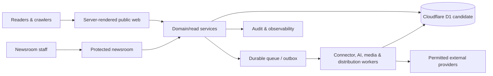

# Architecture Guide

The platform is designed as a human-accountable newsroom with a
server-rendered public experience, a protected editorial application, a
normalized evidence and publishing model, durable background work, provider
adapters, and deterministic publication gates.

## Status

The system ran in production on Cloudflare (Worker, D1, R2, Queues, Cron
Triggers) with live trend connectors, a scheduled AI research/draft/fact-review
pipeline, gate-controlled autonomous publishing, and a daily data-hygiene job.
The sections below describe the boundaries that design relies on.

## Architectural map

Important properties:

- Story Cluster is the canonical event identity.
- Article versions are immutable after publication.
- Claims and evidence precede drafting and remain inspectable.
- Research, drafting, fact review, and approval are independent stages.
- Sensitive content always needs human approval.
- The Publisher is deterministic and cannot waive policy.
- External content is hostile data and uses restricted egress/parsing.
- Search, caches, feeds, and analytics are rebuildable projections.
- Public reading degrades independently from AI, ads, and connectors.

## Technology posture

The repository uses Next.js semantics through vinext on Cloudflare and a
D1-compatible Drizzle schema. Cloudflare D1 is the current deployment
candidate's database target, with Cloudflare-supported durable queues and R2
planned for the provider-dependent paths. The provider adapters remain
neutral. D1 still requires remote migration, capacity, consistency, query,
backup, restore, and operational review before public production.

## Detailed documents

| Topic | Document |
| --- | --- |
| Runtime components, boundaries, and flows | [system-architecture.md](./architecture/system-architecture.md) |
| Normalized entities, invariants, indexes, retention | [data-model.md](./architecture/data-model.md) |
| Jobs, idempotency, retries, outbox, DLQ | [job-pipeline.md](./architecture/job-pipeline.md) |
| Specialized agents and deterministic gates | [ai-agent-design.md](./architecture/ai-agent-design.md) |
| Threat model and controls | [security-model.md](./architecture/security-model.md) |
| Environments, Sites, rollout, rollback | [deployment.md](./architecture/deployment.md) |
| Product contract | [product-requirements.md](./product/product-requirements.md) |
| Editorial state machine | [editorial-workflows.md](./product/editorial-workflows.md) |
| Authorization | [permissions-matrix.md](./product/permissions-matrix.md) |

## Architecture decision rules

1. Put business rules in domain services, not React components or route
   handlers.
2. Validate at every trust boundary.
3. Access providers through interfaces; keep vendor types out of domain records.
4. Make jobs idempotent and external effects reconcilable.
5. Commit audit/outbox records with domain changes.
6. Keep public read models free of draft/private fields.
7. Prefer deterministic code for scoring arithmetic, gates, permissions, and
   state transitions.
8. Add vector search only for a measured use case; PostgreSQL full-text search
   is the default.
9. Prefer graceful feature degradation over article-read failure.
10. Update these documents and acceptance evidence when an architectural
    contract changes.
