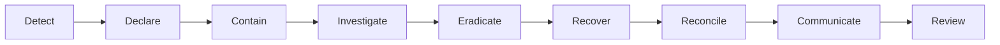

# Incident Response

**Last reviewed:** 2026-07-24

## 1. What is an incident

An incident threatens reader safety/trust, editorial integrity, confidentiality,
privacy, rights, availability, distribution, or material revenue operations.
Examples include false/unauthorized publication, exposed source/reader data,
account compromise, malicious source/AI behavior, widespread outage, corrupt
versions, broken corrections, malware media/ad creative, uncontrolled mail, or
backup failure.

## 2. Severity

| Level | Definition | Examples | Initial response |
| --- | --- | --- | --- |
| SEV-1 | Active severe harm or loss of control | Unauthenticated publish, private-source/reader breach, false death report, malicious public script, unrecoverable corruption | Page immediately; Incident Commander; freeze affected pathways |
| SEV-2 | Major impact with control retained | Public/read outage, sensitive workflow bypass caught before/after limited publish, queue causing duplicate sends, major wrong headline | Respond within 15 minutes during coverage |
| SEV-3 | Limited/degraded impact | One connector down, delayed feed, isolated wrong metadata/ad, noncritical job backlog | Same staffed shift |
| SEV-4 | Low impact or near miss | Cosmetic issue, alert tuning, blocked attack with no impact | Track in normal queue |

Severity can rise as facts develop. Editorial harm may be SEV-1 even when
servers are healthy.

## 3. Roles

- **Incident Commander (IC):** owns priorities, severity, decisions, and
  handoffs.
- **Operations lead:** diagnosis, containment, recovery, and telemetry.
- **Editorial lead:** publication freeze, reader safety, correction/retraction,
  sources, and downstream messaging.
- **Security/privacy lead:** compromise, evidence, credential/data scope,
  notification obligations.
- **Communications lead:** staff, reader, partner, vendor, and regulator
  communication.
- **Scribe:** UTC timeline, actions, evidence, owners, approvals, and status.
- **Subject owner:** connector, database, AI, media, email, ad, or identity
  specialist.

One person may cover roles in a small team, but the IC should not perform every
technical action. Production access follows least privilege and break-glass
logging.

## 4. First 15 minutes

1. Acknowledge the alert/report and open an incident record.
2. Assign IC, severity, affected surfaces, and secure channel.
3. Protect people and editorial accuracy first.
4. Use the narrowest safe kill switch: publication, connector, model/prompt,
   Ask This Story, newsletter, notification, ad vendor/campaign, embeds, or
   personalization.
5. Preserve the exact content version, logs, audit, provider IDs, and relevant
   artifacts with privacy controls.
6. Check for active compromise and rotate/revoke exposed credentials/sessions.
7. State known facts, unknowns, next update time, and owner.

Do not delete evidence, replay queues broadly, restore over production, or make
speculative public claims.

## 5. Response lifecycle



Containment may reduce features while leaving verified article reading
available. Recovery is not complete until editorial/distribution state is
reconciled.

## 6. Common playbooks

### False or unsupported publication

1. Stop promotion, scheduled sends, related auto-publish, and generated answers.
2. Preserve version/approval/evidence.
3. Assign editorial/risk/legal review.
4. Correct or retract at the canonical URL.
5. Update headline, metadata, media, structured data, caches, search, feeds,
   newsletters/notifications, and Story Intelligence.
6. Inspect other content sharing the claim/source/prompt/model.
7. Record reader-facing note and retrospective.

### Unauthorized publication or account compromise

1. Disable publication and affected account/session/service principal.
2. Preserve authentication, authorization, audit, and version evidence.
3. Rotate credentials and remove persistence.
4. Inventory all actions by the principal and related tokens.
5. Restore/correct content through editorial workflows, not history deletion.
6. Test the bypass fix before re-enable.

### Malicious source or prompt/tool injection

1. Disable connector/parser/prompt/Ask feature involved.
2. Quarantine source snapshot and affected jobs/outputs.
3. Confirm no tool, secret, approval, or publish effect occurred.
4. Search correlated runs for similar payload/output.
5. Patch trust-boundary/validation controls and add regression fixture.
6. Reevaluate the model/prompt before re-enable.

### Reader or confidential-source data exposure

1. Stop exposure and preserve access evidence.
2. Involve security/privacy/legal immediately.
3. Determine data categories, people, time range, access/download, regions,
   encryption, and ongoing risk.
4. Revoke sessions/links/credentials and remove public caches safely.
5. Follow applicable notification timelines; communicate verified facts only.
6. Do not place affected private data in the incident chat or ticket.

### Public outage or breaking-news overload

1. Protect cached article reads and trust/correction pages.
2. Shed Ask This Story, personalization, ads, analytics, expensive search, and
   noncritical jobs.
3. Freeze deploys and diagnose release/dependency/capacity.
4. Roll back the compatible artifact/config or fail over.
5. Verify cache freshness so old emergency guidance is not presented as current.

### Queue or distribution failure

1. Pause affected consumers/producers and measure the semantic effect.
2. Separate delayed, duplicate, poison, and stale-version jobs.
3. Protect unsubscribes, corrections, retractions, and publication first.
4. Fix/dedupe; dry-run scoped replay with rate limits.
5. Reconcile external provider receipts before resending.

### Malicious media or advertising

1. Disable the asset/derivative/embed/vendor/campaign/slot globally as needed.
2. Preserve creative/object/checksum/request evidence.
3. Block destination/domain and rotate compromised credentials.
4. Assess malware, privacy, click, accessibility, and affected-reader scope.
5. Replace or remove media and purge caches.
6. Reapprove the pipeline/vendor before re-enable.

### Database corruption or loss

Follow [BACKUP_AND_RESTORE.md](./BACKUP_AND_RESTORE.md). Freeze unsafe writes,
restore in isolation, choose the recovery point explicitly, reconcile
post-boundary editorial/consent actions, and cut over only after integrity tests.

## 7. Communication

Internal status format:

```text
Incident / severity:
Start and current time (UTC):
Reader/editor impact:
Known:
Unknown:
Containment:
Next actions and owners:
Next update:
Decision needed:
```

Public communication should be timely, factual, plain, accessible, and approved
by the IC plus editorial/security/privacy owner as relevant. Avoid unverified
cause, attacker attribution, exposed control detail, private data, or false
certainty. Update the same canonical notice where practical.

Correction notices follow [CORRECTIONS_POLICY.md](./CORRECTIONS_POLICY.md);
security/privacy notification follows applicable legal obligations and counsel,
not this document alone.

## 8. Evidence

Preserve:

- release, configuration, feature, policy, prompt, and model versions;
- article/source/media versions and checksums;
- authentication, authorization, audit, job, provider, and deployment IDs;
- relevant redacted logs/traces/network/security events;
- actions/commands, actors, times, and results;
- screenshots or source samples only when secure and necessary.

Record chain of custody for likely legal/security evidence. Do not retain harmful
or personal content longer than necessary.

## 9. Recovery gates

- Root cause or safe containment understood.
- Compromised credentials/sessions/persistence addressed.
- Publication/content correctness verified by editorial owner.
- Authorization and regression/security tests pass.
- Queues and external effects reconciled idempotently.
- Monitoring/alerts operate.
- Backup state remains safe.
- Gradual re-enable plan and rollback/kill switch ready.
- Stakeholders receive a verified update.

The affected AI model, connector, or automation does not auto-resume solely
because availability returned.

## 10. Post-incident review

Hold a blameless review within five business days for SEV-1/2:

```text
Impact and duration
Detection source and gaps
UTC timeline
Technical/editorial root and contributing factors
What limited harm
What failed
Data/content/provider scope
Correction/notification actions
Security/privacy/legal decisions
Action items with owner/date
Test/runbook/architecture updates
Re-enable decision
```

Track actions to completion. Update policies, evaluations, monitoring, and
training—not only code.
