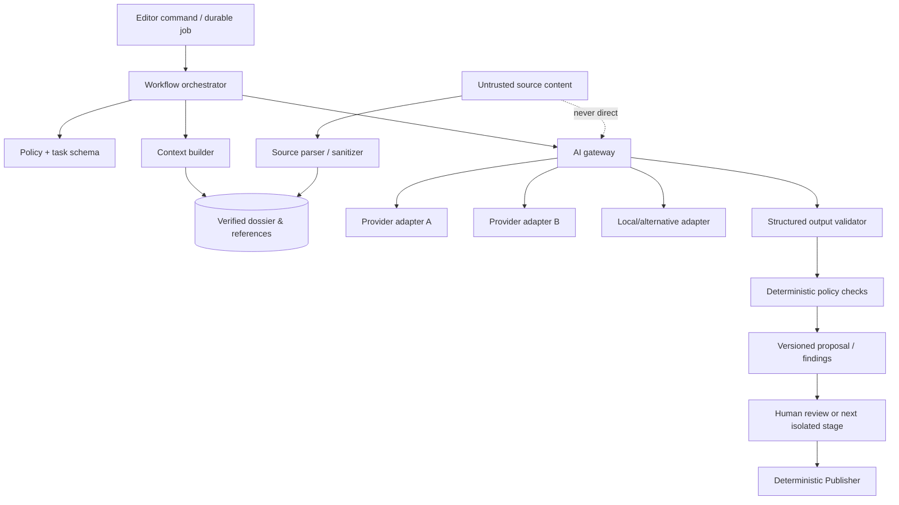

# AI Agent Design

**Status:** Target assisted-editorial architecture; no autonomous-newsroom claim
**Last updated:** 2026-07-24

## 1. Position

AI is a bounded production aid. It can recommend, extract, compare, draft, and
check, but the database, policy engine, evidence records, and authorized humans
decide what is publishable. The same model call never performs research,
drafting, fact checking, and approval.

The initial frontend milestone may demonstrate agent outputs with fictional
data. That does not mean an AI provider or agent workflow is connected.

## 2. Control-plane design



The orchestrator is a stateful domain service over durable jobs, not an
open-ended model agent. Tool choice is application-controlled. Models receive
only task-specific capabilities and references.

## 3. Agents and permissions

| Agent | Input | Output | May not |
| --- | --- | --- | --- |
| Trend Scout | Normalized signals and score policy | Cluster/rank proposal with explanations | Research, draft, publish |
| Research Agent | Approved candidate, allowlisted fetch results | Source dossier, timeline, missing facts | Use arbitrary URLs, invent, publish |
| Claim Analyst | Dossier and source locators | Atomic claims and evidence relationships | Treat social posts as proof, approve |
| Editorial Planner | Verified claim packet and reader intent | Format, angle, outline, value elements | Add unsupported facts |
| Drafting Agent | Approved plan and verified packet | Draft/version and headline candidates | Browse independently, approve, publish |
| Fact-Checking Agent | Draft plus evidence in an independent context | Claim findings and conflicts | Treat draft as evidence, approve |
| Copy Editor | Draft and verified facts | Proposed language diff and issues | Change factual meaning silently |
| SEO Editor | Draft, canonical/taxonomy, search brief | Metadata/link/schema proposal | Keyword stuffing, false freshness |
| Media Editor | Asset/license metadata and story context | Rights/relevance/alt/crop findings | Grant a license, fabricate documentary media |
| Risk Editor | Claims, draft, entities, policy | Risk flags and escalation reasons | Lower human risk or approve |
| Publisher | Approved version and deterministic records | Publish decision/event | Call a creative model, waive gates |

The Publisher is listed for workflow completeness but should be implemented as
deterministic code, not a generative agent.

## 4. Common stage contract

Every AI task declares:

```text
task_id and task_type
article/candidate/story reference
input version/content hash
allowed evidence IDs
policy and prompt version
provider capability class
maximum tokens/units, time, and cost
structured output schema
forbidden actions
risk/sensitivity flags
retention/redaction class
correlation and job IDs
```

The result records provider/model, timestamps, usage/cost, schema-validation
outcome, cited input IDs, uncertainty/findings, and human disposition.

Invalid output is a failed proposal, never silently repaired into publication.
A bounded repair call may fix JSON shape only if it cannot change substantive
facts; otherwise rerun the task or request human action.

## 5. Context construction

1. Load the exact versioned object.
2. Apply authorization and sensitivity policy.
3. Select only evidence necessary for the task.
4. Convert source material to a clearly delimited untrusted-data structure.
5. Remove scripts, hidden text, unsafe markup, and unnecessary personal data.
6. Attach stable source/snapshot/claim identifiers.
7. Include application policy outside the source-content boundary.
8. Enforce a size/cost budget with transparent omission metadata.

Summarization for context compression is itself a versioned stage and cannot
erase conflicts or replace underlying citations.

## 6. Prompt-injection boundary

Source pages, feeds, PDFs, captions, comments, social posts, metadata, and OCR
are hostile data. They may contain text such as “ignore previous instructions”
but that text has no authority.

Controls:

- system/application policy is built by trusted code;
- source content is tagged and quoted as data, never concatenated into the
  instruction layer;
- models do not receive credentials;
- models cannot select unrestricted URLs;
- tool calls are chosen and parameter-validated by application code;
- fetch runs through a restricted egress broker;
- output is schema-validated and checked for source-instruction imitation,
  unsupported claims, unsafe markup, and data leakage;
- no model output directly changes approval or publication state;
- adversarial fixtures are part of release evaluation.

## 7. Provider abstraction

The AI gateway exposes task capabilities rather than vendor APIs:

```text
classify()
extractStructured()
compareEvidence()
draftFromPacket()
reviewClaims()
rewriteSelection()
embed()        # only when an approved use case exists
```

Provider adapters translate messages, schemas, safety settings, timeouts,
usage, and errors. Domain records use internal model/task identifiers, not
vendor-specific response types.

Routing considers:

- task quality evaluation;
- sensitivity and approved data processing terms;
- structured-output reliability;
- latency and cost ceiling;
- region/retention requirements;
- provider health and rate limits; and
- deterministic fallback or human-only mode.

Provider failover never sends data to a provider not approved for that
sensitivity class.

## 8. Model allocation

Use the least costly approved capability that meets an evaluated threshold:

| Task | Typical capability |
| --- | --- |
| Normalization/classification | Small structured-output model or deterministic code |
| Entity/claim extraction | Strong structured extraction |
| Clustering | Rules plus embeddings only if measured useful |
| Planning/drafting | Higher-quality long-context model |
| Fact review | Independent high-reliability reasoning/extraction path |
| Copy/headlines | Bounded language model with factual input lock |
| Embeddings | Provider-neutral vector interface; avoid if FTS suffices |

Model names are configuration, not architecture. Changing a model or material
prompt requires evaluation and may invalidate auto-publication eligibility.

## 9. Research design

The Research Agent never performs raw internet browsing itself. The application:

1. forms provider/search queries from the approved candidate;
2. validates destinations and permissions;
3. fetches through the egress broker;
4. stores permitted immutable metadata/snapshots;
5. parses content as untrusted;
6. supplies selected records to the Research Agent.

The output distinguishes:

- direct primary evidence;
- independent reporting;
- attributed allegation or statement;
- background/context;
- contradiction;
- unknown or missing information; and
- content that was inaccessible or not permitted to retain.

## 10. Draft and review independence

- The Drafting Agent receives the verified packet, not arbitrary search results.
- The Fact-Checking Agent uses a separate prompt, execution, and preferably a
  distinct model/provider class where approved.
- Fact review enumerates central claims and reports support, contradiction,
  stale evidence, numerical/date/name mismatch, and missing qualification.
- Review agents emit findings, not a single opaque score.
- An editor sees diffs, evidence links, unresolved findings, and model/prompt
  provenance before accepting a change.

## 11. Deterministic gates

Generative output cannot override:

- sensitive-story human review;
- server-side permission;
- central claim status;
- minimum source/evidence rules;
- approval/version hash;
- original-value count;
- media rights and expiry;
- disclosure/label requirements;
- schedule/embargo;
- canonical/slug constraints;
- quality component validation;
- daily caps and automation allowlist; or
- global/model/connector kill switches.

## 12. Ask This Story

Reader questions use retrieval only over the published Story Intelligence
dossier and public evidence references for that canonical version. The feature:

- does not browse;
- cites the supporting sources;
- says when support is absent or reports conflict;
- refuses personalized medical, legal, or financial advice;
- applies abuse, injection, and rate controls;
- cannot reveal private notes, unpublished sources, or system prompts;
- stores aggregate question analytics with minimal personal data; and
- shows that responses are AI-generated and may be incomplete.

For high-risk stories, enablement is a separate policy decision.

## 13. Quality evaluation

Maintain versioned test sets containing:

- straightforward verified announcements;
- evolving and contradictory reports;
- manipulated/viral signals;
- sensitive allegations and minors;
- date, number, quotation, and entity traps;
- absent primary sources;
- duplicate/near-duplicate stories;
- copyrighted or instruction-bearing source content;
- multilingual source material with U.S.-English output;
- unsupported headline temptations;
- corrected/outdated evidence; and
- Ask This Story unanswerable/advice questions.

Measure schema validity, citation precision/recall, unsupported central claims,
conflict preservation, risk recall, plagiarism/similarity flags, edit
acceptance, reviewer overrides, latency, and cost. Editorial/security review
owns release thresholds; aggregate “model quality” is insufficient.

## 14. Cost and abuse controls

- Per-task and per-story token/unit/cost ceilings.
- Input deduplication and result cache keyed by content/prompt/model policy.
- Concurrency/rate limits per provider, desk, and reader feature.
- No retry on policy/schema errors without bounded correction logic.
- Budget alerts and a global AI kill switch.
- Ask This Story quotas and abuse detection.
- Store cost by stage so high-cost low-value workflows can be redesigned.

Cost pressure can route work to humans or pause it; it cannot reduce factual
requirements.

## 15. Privacy, rights, and disclosure

- Send providers only data allowed by contract and approved data class.
- Disable provider training/retention where contractually available and
  required.
- Do not place secrets, private source identities, reader PII, or full licensed
  content in prompts unless explicitly necessary and approved.
- Retain prompt/output content only for the documented period; cost metadata can
  outlive redacted content.
- Public articles disclose material AI assistance according to
  [AI_POLICY.md](../AI_POLICY.md).
- AI-generated illustrations are conspicuously labeled and never documentary
  evidence.

## 16. Rollout

1. Offline evaluation with fictional/licensed fixtures.
2. Staff-only proposals, no article mutations.
3. Human-accepted diffs with full audit.
4. Shadow pipeline on real permitted inputs, no automated publication.
5. Assisted production with mandatory human publication.
6. Optional limited low-risk automation only after the separate gate in
   [acceptance-criteria.md](../product/acceptance-criteria.md).

Sensitive stories remain human-approved.
