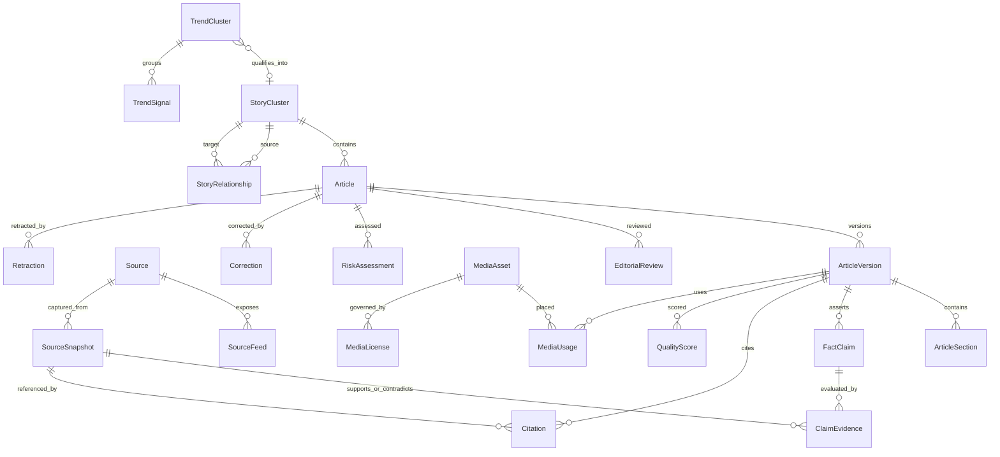
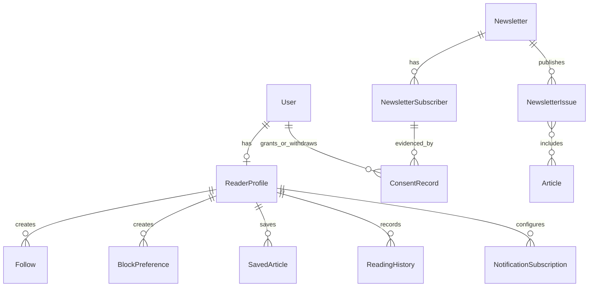

# Data Model

**Status:** Normalized production target; not evidence of implemented tables
**Last updated:** 2026-07-24

## 1. Current and target state

The repository baseline includes a Drizzle D1 adapter and initially empty schema.
That is enough to establish a typed persistence seam, not to claim a production
database.

The target model uses PostgreSQL as the transactional system of record. UUIDv7
or another time-sortable opaque identifier is recommended. All timestamps are
stored in UTC; display layers show explicit timezone context. Table and column
naming should be consistent `snake_case`, while domain types can use idiomatic
TypeScript names.

## 2. Core invariants

1. A published `ArticleVersion` is immutable.
2. A correction creates a new version and a `Correction`; it never overwrites
   history.
3. Every article belongs to at most one canonical `StoryCluster`; relationships
   connect related clusters.
4. Every central published `FactClaim` has allowable verification state and
   evidence.
5. An approval binds to article version, content hash, policy version, and
   reviewer.
6. Media cannot be used without an approved `MediaUsage` backed by a current
   license/permission decision.
7. Editorial state changes and high-impact actions create `AuditLog` records.
8. Provider, search, cache, and analytics records are not sources of editorial
   truth.
9. Reader PII is separated from public author/editorial identities.
10. Deleting an account does not erase legally necessary, de-identified
    editorial audit history.

## 3. Editorial core

## 4. Identity and authorization

| Entity | Purpose and important constraints |
| --- | --- |
| `User` | Internal or reader identity anchor; status and verified identity reference. |
| `Account` | External identity-provider account; unique provider/subject pair. |
| `Session` | Rotatable, revocable session; hash tokens and record expiry. |
| `Role` | Named permission bundle, scoped to organization. |
| `Permission` | Stable action key such as `article.publish`. |
| `UserRole` | User-role assignment with scope, grantor, and expiry. |
| `AuthorProfile` | Public byline identity, biography, disclosures, and status; not the auth record. |
| `EditorialTeam` | Desk/section membership and assignment scope. |

Use join tables such as `role_permission` and `editorial_team_member` even when
not exposed as top-level domain objects. A role in a request is never trusted;
effective permissions are loaded server-side.

## 5. Taxonomy and entities

| Entity | Purpose |
| --- | --- |
| `Category` | Small controlled navigation taxonomy; one primary category per article. |
| `Tag` | Lightweight editorial descriptor; governed to avoid keyword-page sprawl. |
| `Topic` | Durable subject with public page eligibility and editorial description. |
| `Entity` | Canonical supertype with aliases and external identifiers. |
| `Person` | Person-specific fields linked one-to-one to `Entity`. |
| `Organization` | General institution or group linked to `Entity`. |
| `Company` | Commercial organization subtype and identifiers. |
| `SportsTeam` | League/team subtype and identifiers. |
| `Location` | Normalized geography with approximate hierarchy/coordinates. |

Join entities include `ArticleEntity`, `ArticleTopic`, and `article_tag`.
Aliases use normalized uniqueness within entity type and locale. Trend terms do
not create public topics automatically.

## 6. Sources and evidence

| Entity | Purpose and important fields |
| --- | --- |
| `Source` | Name, domain, publisher, type, country, ownership, tier, primary status, citation and license rules, reliability notes, review time. |
| `SourceRating` | Licensed third-party rating, provider, methodology/version, attribution, validity period; never an invented platform bias score. |
| `SourceFeed` | Connector/feed endpoint, format, scope, terms, schedule, cursor, enabled status. |
| `SourceSnapshot` | Immutable retrieval metadata, checksum, storage reference, legal-retention decision, published/retrieved times. |
| `ResearchDossier` | Candidate/story research packet, status, owner, summary, missing information, approved input version. |
| `ResearchNote` | Attributed note with source reference, author, timestamps, and classification. |
| `FactClaim` | Atomic claim, section locator, category, centrality, verification state, risk, reviewer, reviewed time. |
| `ClaimEvidence` | Claim-snapshot link with relation (`SUPPORTS`, `CONTRADICTS`, `CONTEXT`), excerpt locator, reviewer, and weight notes. |
| `Citation` | Rendered article citation linking a version/section/range to evidence and display text. |
| `ArticleSource` | Article-source role and independence determination. |

Source content may be stored only when permission and retention policy allow.
Otherwise the snapshot stores normalized metadata, checksum, permitted excerpt
or locator, and retrieval facts.

## 7. Trends and Story Intelligence

| Entity | Purpose |
| --- | --- |
| `TrendSignal` | Immutable provider observation: original term, market, time window, velocities, raw provenance reference. |
| `TrendCluster` | Normalized term, related terms, category, entities, U.S. relevance, novelty, coverage, media/source availability, risk, explained score, editorial state. |
| `StoryCluster` | Canonical event identity, slug, status, summary, latest development, and current public projection. |
| `StoryRelationship` | Typed directed relationship between clusters: background, consequence, comparison, correction, predecessor, related. |

Trend score components should be child rows or a validated JSON structure with a
versioned scoring policy. Persist raw component values and explanations; never
store only a total.

## 8. Articles and publication

| Entity | Purpose and important constraints |
| --- | --- |
| `Article` | Stable identity: format, cluster, primary category, owner, workflow state, sensitivity, current draft/published pointers. |
| `ArticleVersion` | Immutable snapshot of headline variants, subheadline, body document, disclosures, timestamps, author set, content hash, creator. |
| `ArticleSection` | Structured block/order data for claim locators, rendering, and diffing. |
| `ArticleEntity` | Article/entity relation and role. |
| `ArticleTopic` | Article/topic relation and primary/secondary flag. |
| `HeadlineCandidate` | Variant type, text, component scores, risk, model/human provenance, disposition. |
| `EditorialReview` | Review type, version/hash, decision, findings, reviewer, policy version, completed time. |
| `RiskAssessment` | Risk categories, level, reasons, human/AI provenance, cannot-be-lowered flag. |
| `QualityScore` | Versioned component scores, explanations, hard-gate results, total, policy version. |
| `PublicationSchedule` | Version, embargo/schedule time, timezone, creator, cancellation, idempotency key. |
| `ArticleUpdate` | Material update note linking previous/new versions and public explanation. |
| `Correction` | Error description, severity, affected version, corrected version, public note, reporter, approver. |
| `Retraction` | Reason class, public notice, legal restrictions, authority, effective time. |
| `Redirect` | From/to paths, status, reason, owner, expiry if temporary. |
| `InternalLink` | Source/target version or canonical, anchor, relationship, validation state. |

The article body should use a versioned structured document format validated
against allowed block schemas. Raw executable HTML is not stored as trusted
content.

## 9. Media and live coverage

| Entity | Purpose |
| --- | --- |
| `MediaAsset` | Original/stored names, origin, creator/rightsholder, checksum, MIME, dimensions, focal point, alt/caption, scan and verification states. |
| `MediaLicense` | License/permission type, URL/evidence, attribution, territories, channels, expiry, restrictions, reviewer. |
| `MediaUsage` | Asset-to-version placement, crop/derivative, label, approval, current license decision. |
| `LiveBlog` | Stable live event container, article/cluster, status, opened/closed times, editors. |
| `LiveBlogEntry` | Immutable entry version, event/publish time, author/desk, source, verification, media/embed, correction link. |

Object keys are opaque and private by default. Public delivery uses approved
derivatives, not original upload paths.

## 10. Reader, consent, and distribution

| Entity | Purpose |
| --- | --- |
| `ReaderProfile` | Minimal reader preferences and default feed/summary mode. |
| `Follow` | Polymorphic follow of a topic/entity/team/author; unique per profile/target. |
| `BlockPreference` | Topic/source block with public-interest override behavior. |
| `SavedArticle` | Reader/article save with unique constraint. |
| `ReadingHistory` | Optional consented history with retention/clear controls. |
| `NotificationSubscription` | Channel, target, frequency, consent, quiet hours, status. |
| `Newsletter` | Publication definition, audience, cadence, archive and sponsor policy. |
| `NewsletterIssue` | Immutable reviewed issue/version, schedule/send status and content. |
| `NewsletterSubscriber` | Normalized/hardened address reference, status, locale, preferences. |
| `ConsentRecord` | Purpose, policy/vendor version, action, source, region, timestamp, proof, withdrawal link. |

Email addresses and notification endpoints are encrypted or tokenized where
appropriate and never copied into analytics event payloads.

## 11. Revenue

| Entity | Purpose |
| --- | --- |
| `AdSlot` | Named placement, supported formats, reserved dimensions, page/safety restrictions. |
| `Advertiser` | Legal/customer record, status, contacts, policy review. |
| `Campaign` | Dates, budget, targeting, caps, approval, labels, status. |
| `Creative` | Asset/copy, click destination, scan and policy results, versions. |
| `AdImpression` | Minimal event with dedupe/fraud signals and privacy-safe dimensions. |
| `AdClick` | Minimal click event with dedupe/fraud signals; never used to manufacture clicks. |
| `Sponsor` | Public sponsor identity and disclosures. |
| `SponsoredArticle` | Link between distinct sponsored content and campaign/sponsor approvals. |
| `AffiliateLink` | Destination, network, disclosure, relationship, validity and click token rules. |

Revenue records cannot alter article facts, quality scores, or editorial rank.
Separate database roles or service boundaries should enforce the separation for
high-risk operations.

## 12. Search, analytics, operations, and AI

| Entity | Purpose |
| --- | --- |
| `AnalyticsDaily` | Aggregated content/channel metrics; privacy thresholds and source freshness. |
| `SearchQuery` | Privacy-minimized internal query aggregate or sampled event. |
| `SearchPerformance` | Search platform metrics by canonical/date, imported with provenance. |
| `JobDefinition` | Named job type, schema version, queue, timeout, retry and concurrency policy. |
| `JobRun` | Attempt-independent logical run, idempotency key, input version, state, trace, timing. |
| `JobFailure` | Attempt/failure class, redacted error, retry time, DLQ disposition. |
| `Connector` | Type, credentials reference, permitted use, limits, attribution, cache, market/category scope. |
| `ConnectorHealth` | Sync/failure times, counts, circuit state, latency, health score with explanation. |
| `AIProvider` | Provider/config capability metadata and credential reference, never the secret. |
| `AIUsage` | Task, provider/model, prompt version, tokens/units, cost, latency, outcome, trace. |
| `PromptVersion` | Immutable prompt/policy templates, checksum, owner, evaluation status and effective window. |
| `FeatureFlag` | Typed flag, environment, owner, expiry, rollout, kill-switch class. |
| `SystemSetting` | Versioned non-secret configuration with validation and audit. |
| `AuditLog` | Append-only actor/action/target/decision/reason/policy/request metadata. |

`AIUsage` references source/dossier records rather than duplicating sensitive
prompt content into a cost table.

## 13. State and enum guidance

Store enums as constrained text or lookup tables with deliberate migrations.
Important controlled values include:

- editorial states listed in
  [editorial-workflows.md](../product/editorial-workflows.md);
- claim verification states;
- article formats;
- risk categories and levels;
- review types/decisions;
- evidence relationships;
- media verification/license/usage states;
- live-blog states;
- job/circuit states;
- consent action and purpose;
- campaign/creative states.

Unknown provider-specific values belong in adapter metadata, not core enums.

## 14. Integrity and concurrency

- Use foreign keys and uniqueness constraints instead of application-only
  assumptions.
- Use transactions for state transitions, approvals, schedule changes,
  publication, corrections, and permission assignments.
- Use a revision number or content hash for optimistic concurrency in editors.
- A review has a unique active decision per type/version/policy; superseding it
  appends a record.
- The publication pointer references exactly one immutable version.
- Claim evidence cannot reference a snapshot hidden by legal hold without an
  explicit, auditable handling state.
- Job idempotency keys are unique within job definition and semantic scope.
- Outbox records commit in the same transaction as domain changes.

## 15. Indexing plan

At minimum review indexes for:

- article canonical slug and published time;
- Latest `(status, published_at desc, id desc)`;
- article workflow state/assignee/updated time;
- Story Cluster slug/status/latest update;
- trend market/state/score/latest detection;
- normalized entity/topic aliases;
- claim article-version/centrality/status;
- source domain and snapshot checksum;
- review article-version/type/decision;
- schedule state/due time;
- correction/retraction article/effective time;
- job queue/state/run-after and idempotency key;
- connector enabled/next-sync/circuit state;
- reader follow/save unique pairs;
- newsletter subscription normalized address/status;
- redirect source path;
- public full-text vector and visibility filter.

Use partial indexes for active/due/public subsets and cursor pagination for large
feeds. Validate with real query plans before launch.

## 16. Retention and deletion

| Data | Default policy direction |
| --- | --- |
| Published versions/corrections/retractions | Preserve as editorial record, subject to legal/privacy action |
| Drafts and research | Retain per editorial/legal schedule; restrict access |
| Source snapshots | Contract- and license-specific; delete binary when no longer permitted |
| Audit/security events | Append-only for approved period; redact unnecessary PII |
| Reader history | Short, consented, user-clearable |
| Consent evidence | Retain long enough to prove grant/withdrawal obligations |
| Raw analytics | Minimize and aggregate quickly |
| Job payloads/logs | Short-lived; references instead of copied source/PII |
| AI prompts/outputs | Policy-specific minimum; do not use for provider training without approval |
| Media originals | License/legal hold and usage lifecycle |

Retention values require counsel and actual vendor review before production.

## 17. Migration approach

1. Generate migration files; never rely on runtime schema synchronization.
2. Test forward migration against production-shaped data.
3. Use expand/migrate/contract for zero-downtime changes.
4. Deploy code compatible with old and new schema before backfills.
5. Make backfills restartable, observable, rate-limited, and idempotent.
6. Keep irreversible/destructive steps in a later reviewed release.
7. Take and verify a restorable backup before high-risk changes.
8. Record migration version in health/readiness output.

## 18. Related documents

- [Database operations](../DATABASE.md)
- [System architecture](./system-architecture.md)
- [Backup and restore](../BACKUP_AND_RESTORE.md)
