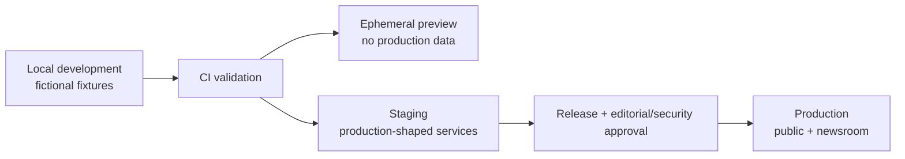
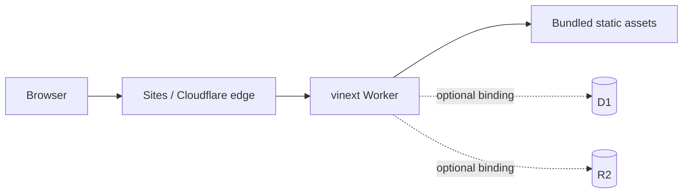
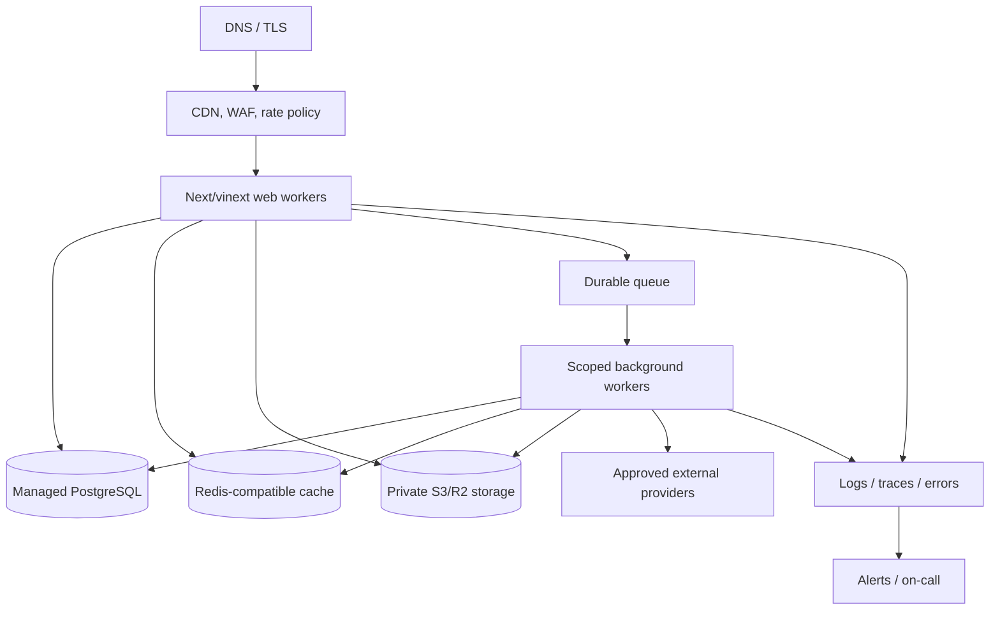

# Deployment Architecture

**Status:** Reference repository deployment plus target production topology
**Last updated:** 2026-07-24

## 1. Deployment paths

This repository is configured as a vinext application for Cloudflare and
contains `.openai/hosting.json`. Site creation, saved versions, environment
variables, access policy, and production deployment therefore use the Sites
control plane. Do not invent project IDs or manually edit a returned opaque ID.

Two deployment profiles are intentionally distinct:

| Profile | Purpose | Data/service posture |
| --- | --- | --- |
| Reference site | Demonstrate the cohesive frontend with fictional data | May be stateless; no claim of live newsroom operations |
| Production newsroom | Operate ingestion, persistence, editorial workflow, and distribution | Requires production DB, queue/cache, object storage, identity/RBAC, providers, monitoring, backups |

A successful reference-site deployment is not production-newsroom readiness.

### Container status

The baseline repository does not contain a development Compose file or
production Dockerfile. The reference site uses the Sites/vinext path and must
not claim container support.

If production domain APIs or durable workers are hosted outside Sites, add and
test:

- a pinned multi-stage production image;
- a non-root runtime user, read-only filesystem, minimal packages, health
  check, signal-aware shutdown, and explicit resource limits;
- a local Compose profile for PostgreSQL, queue/cache, and compatible object
  storage using synthetic data;
- image vulnerability/license scanning and provenance; and
- documented build, migration, deploy, rollback, and secret-injection commands.

Choose this only with the final runtime topology; an unused Dockerfile is not a
deployment capability.

## 2. Environments

| Environment | Data | Integrations | Access |
| --- | --- | --- | --- |
| Local | Fictional seed data | Mocks/sandboxes | Developer machine |
| Preview | Fictional or isolated test data | Mocks/sandboxes | Authenticated reviewers |
| Staging | Synthetic production-shaped data | Provider sandboxes or restricted test accounts | Staff only |
| Production | Real editorial/reader data | Approved live providers | Public reader surface; protected newsroom |

Never clone production reader data, private sources, secrets, or licensed
snapshots into preview/local environments.

## 3. Reference deployment topology

The baseline `.openai/hosting.json` can declare D1/R2 binding names, but a
non-null name is not enough: the actual environment binding, migrations,
permissions, backup posture, and runtime tests must also exist.

## 4. Target production topology

The public web application may remain at the edge while durable workers and
data services use managed regional infrastructure:

If edge-to-database connection behavior cannot meet security, latency, pooling,
and transaction requirements, place domain APIs/workers near PostgreSQL and
keep the edge as the rendering/cache layer. This is an explicit performance
test decision, not an assumption.

## 5. Configuration classes

| Class | Examples | Storage |
| --- | --- | --- |
| Build-time public | release ID, non-secret feature compilation | CI/build config |
| Runtime non-secret | base URL, region, provider mode, public IDs | Sites/runtime environment |
| Runtime secret | DB URL, auth secrets, API keys, signing keys | Deployment secret manager |
| Editorial policy | thresholds, sensitive categories, caps | Versioned database config with audit |
| Kill switches | connectors, AI, auto-publish, mail, ads | Fast server-side feature/config service with audit |

Secrets never go in source, client bundles, logs, `.openai/hosting.json`, or
documentation. Production startup/readiness fails clearly when required
variables or bindings are absent.

## 6. CI/CD gates

1. Install from the lockfile with the supported Node version.
2. Run secret and dependency/license scans.
3. Run lint, strict type checking, unit/integration tests, and production build.
4. Run rendered-HTML, accessibility, and route smoke tests.
5. Run security tests proportional to changed boundaries.
6. Generate migration plan and inspect destructive/locking risk.
7. Build one immutable artifact and record commit/release provenance.
8. Deploy to preview/staging.
9. Run smoke, migration, authorization, publication, and rollback checks.
10. Require release approval for production.
11. Deploy the exact saved/reviewed version.
12. Observe canary/initial traffic and complete post-deploy verification.

Never save or deploy a Sites version from source different from the referenced
commit. Every Sites deployment URL is a production deployment; use verified
owner-only deployment where applicable, otherwise obtain explicit approval for
shared/public deployment.

## 7. Database changes

- Migrations are committed, reviewed, ordered, and forward tested.
- Use expand/migrate/contract for online changes.
- Take a verified backup before high-risk changes.
- Apply migrations with a dedicated role and advisory lock.
- Web and worker versions remain compatible during rollout.
- Backfills are separate idempotent jobs with throttling and progress.
- Destructive cleanup ships only after all readers are migrated and rollback
  window closes.

D1 and PostgreSQL migrations are not interchangeable. The production database
decision must be made before generating the real schema history.

## 8. Release strategy

Prefer canary or gradual traffic where the platform supports it:

1. deploy with risky features off;
2. verify health/readiness and schema version;
3. send internal/synthetic traffic;
4. raise traffic gradually while watching error, latency, resource, job, and
   editorial-publication metrics;
5. enable feature flags separately; and
6. keep previous compatible artifact available.

AI model/prompt changes, connector changes, scoring policy, sensitive policy,
and auto-publication are operational releases even if application code does not
change.

## 9. Rollback

Application rollback:

- disable affected feature/connector/model first when that stabilizes impact;
- route to the previous compatible artifact;
- verify public read, newsroom access, publication state, queues, and
  distribution;
- reconcile events created during the window.

Database rollback:

- prefer forward repair; do not down-migrate destructive changes during an
  incident;
- use the compatibility window from expand/migrate/contract;
- restore only when corruption/loss analysis justifies the RPO impact and
  Incident Commander approves.

Editorial rollback is not a code rollback. Incorrect published content follows
the correction/retraction workflow and preserves history.

## 10. Health endpoints

| Endpoint class | Purpose |
| --- | --- |
| Liveness | Process/event loop responds; no expensive dependencies |
| Readiness | Required config, schema compatibility, DB and critical local dependencies |
| Deep/operator health | Queue, storage, search, connectors, AI, mail, costs; protected |

Public health output reveals no versions, hostnames, credentials, queue names,
or provider details useful to attackers.

## 11. Post-deploy checks

- Public homepage, Latest, representative article, Story Intelligence, search,
  policy page, sitemap/feed, 404 and 410.
- Newsroom sign-in, membership/RBAC denial, trend/research/draft/review views.
- A safe staging publication and correction through the complete workflow.
- Cache invalidation and search/feed/sitemap reconciliation.
- Media delivery, CSP/security headers, consent and ad-disabled behavior.
- Queue consumption, DLQ visibility, connector/model kill switches.
- Logs/traces/errors and alert test.
- Build/release ID and database schema match the approved release.

## 12. Capacity and resilience

Before production, load test:

- cached and uncached article reads;
- homepage and Latest queries;
- breaking-news cache stampede;
- newsroom concurrent editing/optimistic conflict;
- connector bursts and provider rate limits;
- queue backlog/recovery;
- image transformation abuse;
- sitemap/feed generation;
- notification/newsletter fan-out; and
- search and Ask This Story abuse.

Document autoscaling bounds, database connection budgets, provider quotas, and
cost ceilings. A traffic spike should shed personalization, AI, ads, and
nonessential analytics before article reading.

## 13. Ownership

| Area | Accountable owner |
| --- | --- |
| Application release | Engineering release owner |
| Database migration | Data/backend owner |
| Editorial policy/config | Editor-in-Chief or delegate |
| Security controls/secrets | Security owner |
| Provider terms/credentials | Integration owner |
| Production deployment approval | Release owner plus business/editorial owner |
| Auto-publication enablement | Editorial, engineering, security, and legal/policy sign-off |

## 14. Related runbooks

- [Deployment procedure](../DEPLOYMENT.md)
- [Setup](../SETUP.md)
- [Database](../DATABASE.md)
- [Backup and restore](../BACKUP_AND_RESTORE.md)
- [Incident response](../INCIDENT_RESPONSE.md)
- [Launch checklist](../LAUNCH_CHECKLIST.md)
