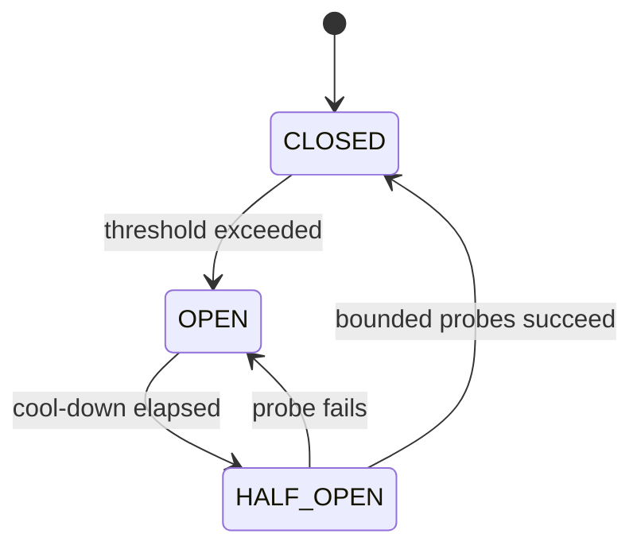
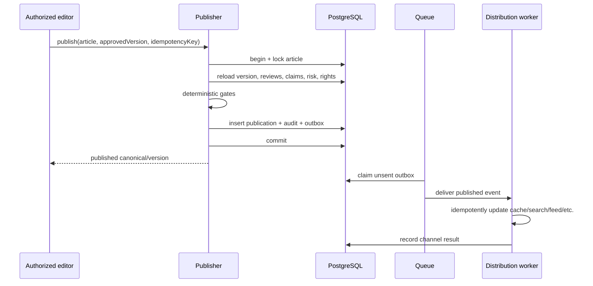

# Durable Job Pipeline

**Status:** Target contract; requires a connected durable queue and workers
**Last updated:** 2026-07-24

## 1. Purpose

Trend ingestion, research, AI calls, media processing, publication side effects,
and distribution are asynchronous. They must not make public page requests slow
or allow one provider failure to stop the newsroom.

The system guarantees **at-least-once delivery with idempotent effects**, not
magical exactly-once execution.

## 2. Pipeline overview

```mermaid
flowchart LR
    Schedules["Schedules / webhooks / editor commands"] --> Ingest["Connector ingest"]
    Ingest --> Normalize["Normalize & validate"]
    Normalize --> Cluster["Trend/story clustering"]
    Cluster --> Score["Explainable scoring"]
    Score --> Candidate["Editorial candidate"]
    Candidate --> Research["Research dossier"]
    Research --> Claims["Claim extraction"]
    Claims --> Plan["Editorial plan"]
    Plan --> Draft["Draft proposal"]
    Draft --> Fact["Independent fact review"]
    Fact --> Specialist["Media / SEO / risk review"]
    Specialist --> Human["Human editorial review"]
    Human --> Publisher["Deterministic publisher"]
    Publisher --> Outbox["Transactional outbox"]
    Outbox --> Distribution["Cache / search / feeds / sitemap / mail"]

    Ingest -. failure .-> DLQ["Dead-letter & operator triage"]
    Research -. failure .-> DLQ
    Draft -. failure .-> DLQ
    Distribution -. failure .-> DLQ
```



No queue transition itself grants editorial approval. Domain state changes go
through the editorial service and state-machine guards.

## 3. Queue families

| Queue | Examples | Priority/concurrency |
| --- | --- | --- |
| `signals` | provider ingest, feed polling, webhook normalize | Per-provider rate limits; isolated lanes |
| `clusters` | normalize, entity resolution, dedupe, score | Bounded CPU/model concurrency |
| `research` | source discovery/fetch, dossier assembly, snapshots | Restricted egress; source-domain caps |
| `editorial-ai` | claim, plan, draft, fact, copy, SEO, risk proposals | Per-task model budgets and isolation |
| `media` | scan, metadata, derivatives, rights expiry | File-size and decompression limits |
| `publication` | due schedules, deterministic publish command | Low concurrency, strict serialization per article |
| `distribution` | search, cache, feeds, sitemaps, notifications | Independent idempotent channels |
| `maintenance` | retention, reconciliation, reindex, cost aggregation | Low-priority, pausable |
| `dead-letter` | terminal failures by queue/job type | Manual or policy-approved replay |

Critical publication/distribution jobs must not compete with bulk backfills.

## 4. Job envelope

Every job uses a versioned, validated envelope:

```text
job_id                 opaque logical run ID
job_type               stable name
schema_version          payload contract version
idempotency_key         semantic effect key
tenant_id               organization boundary
actor                   user/service principal
subject_type / id       target object
expected_revision       optimistic concurrency input
correlation_id          end-to-end trace
causation_id            command/event that created this job
priority                bounded enum
attempt                 delivery attempt
not_before / deadline   scheduling bounds
policy_version          relevant rules
payload_ref             database/object reference, not copied secret content
created_at              UTC
```

Payloads never contain credentials, raw session tokens, unnecessary PII, or
complete licensed source documents.

## 5. Scheduling

Suggested starting cadence after connectors exist:

| Work | Cadence |
| --- | --- |
| Fast trend/source refresh | Every 15–30 minutes, provider terms permitting |
| Cluster/score refresh | After ingest plus several ranked batches per day |
| Developing-story monitor | Risk- and importance-based; no fake freshness |
| Due publication | Every minute or provider-native delayed delivery |
| Feed/sitemap reconciliation | Event-driven plus periodic reconciliation |
| Connector health | Each run plus periodic stale-source detection |
| Cost and analytics rollup | Hourly/daily |
| Rights/license expiry | Daily with advance warnings |
| Retention | Daily low-priority sweep |
| Backup verification | Per backup policy |

Schedules include jitter so instances do not stampede providers. Webhooks are
signature-validated and still enqueue work rather than executing the pipeline
inline.

## 6. Idempotency

Examples:

| Effect | Idempotency key |
| --- | --- |
| Provider page ingestion | connector + provider cursor/item ID + content checksum |
| Normalized signal | connector + source signal ID + normalization policy |
| Snapshot | canonical URL + retrieved representation checksum + permitted scope |
| AI stage | task + input content hash + prompt version + model policy |
| Article publication | article + approved version + publication intent |
| Search indexing | canonical + published version |
| Feed entry | feed + canonical + published version |
| Newsletter delivery | issue + subscriber + channel |
| Media derivative | asset checksum + transform spec + policy version |

Workers claim a key, check an existing successful effect, and commit result plus
outbox/audit in a transaction. External APIs that provide their own idempotency
key receive ours. Repeated delivery returns the previous result without
duplicating side effects.

## 7. Retry policy

Classify failures before retrying:

| Class | Examples | Action |
| --- | --- | --- |
| Transient | timeout, 429, provider 5xx, lock conflict | Exponential backoff with jitter; honor `Retry-After` |
| Dependency degraded | repeated provider failures | Open circuit; probe later; continue other providers |
| Invalid input | schema failure, unsupported content type | Do not retry; quarantine/DLQ |
| Policy block | disallowed URL, missing rights, sensitive gate | Record blocked result; no automatic retry |
| Stale input | version changed during work | End safely; enqueue a new job only if current state needs it |
| Permanent external | deleted resource, revoked permission | Mark unavailable and notify owner |
| Unknown/bug | unhandled exception | Small retry count, then DLQ and alert |

Retry counts and timeouts are defined per `JobDefinition`, not hidden in worker
code. Model and connector budgets stop runaway retry costs.

## 8. Circuit breakers and bulkheads

Circuit state is per connector/provider capability, not global:



Separate concurrency pools protect:

- each source/provider;
- AI provider and model;
- media processing;
- publication;
- newsletter/notification delivery; and
- maintenance/backfills.

A provider's health score is explained by success rate, freshness, latency,
rate-limit pressure, and circuit state. It is not a hidden AI score.

## 9. Stage contracts

| Stage | Reads | Writes | Completion condition |
| --- | --- | --- | --- |
| Ingest | Connector config and cursor | Immutable raw observation reference, new cursor transactionally | Response validated and attribution/terms recorded |
| Normalize | Raw observation | Normalized `TrendSignal` | Original value preserved; market/time/entity fields validated |
| Cluster | Signals and existing clusters | Membership proposals/decisions | Duplicate/near-duplicate explanation stored |
| Score | Cluster and policy | Component scores and total | All positive/negative components explained |
| Research | Approved candidate and fetch results | Dossier, notes, snapshots | Sufficient evidence or explicit insufficiency |
| Claim | Dossier | Atomic claim/evidence proposals | Centrality and support/conflict state present |
| Draft | Approved packet/outline | New draft version proposal | No unsupported input references |
| Fact review | Draft plus evidence independently | Review findings | Central claims evaluated |
| Specialist review | Version plus relevant records | Review findings | Rights/SEO/risk decisions explicit |
| Publish | Approved immutable version | Publication record and outbox | All hard gates pass atomically |
| Distribute | Published event | Channel-specific projection | External effect reconciled or terminally recorded |

## 10. Publication and outbox



The outbox dispatcher may deliver more than once. Each consumer deduplicates.
An AI or connector outage is never part of the publication transaction.

## 11. Dead-letter operations

DLQ entries include job/reference, attempts, redacted failure class, last error,
policy/input versions, timestamps, and suggested owner. Operators can:

- inspect without exposing source secrets or PII;
- retry the same idempotency key after dependency recovery;
- supersede with a new input/policy version;
- cancel with reason;
- quarantine malicious input; or
- escalate a code defect/security incident.

Bulk replay requires dry-run counts, scoped filters, rate/concurrency limits,
and approval. Never blindly replay publication or notification jobs.

## 12. Reconciliation

Periodic reconcilers compare desired and actual state:

- published canonicals versus search documents;
- current versions versus cache tags;
- public articles versus feed/sitemap entries;
- newsletter issue recipients versus provider receipts;
- stored media usage versus license expiry;
- schedules versus publication state;
- connector cursors versus successful ingest;
- outbox records versus consumer acknowledgments.

Reconciliation produces idempotent repair jobs and metrics. It does not silently
edit editorial content.

## 13. Observability

Metrics:

- queue depth, oldest age, throughput, retries, terminal failures;
- duration and success by job/provider/model/prompt version;
- connector freshness, rate-limit headroom, and circuit state;
- AI token/unit cost by stage and story;
- publish-gate failure reason;
- distribution lag by channel;
- duplicate/idempotency hit rate; and
- DLQ age and owner.

Logs use correlation/causation/job IDs and redact credentials, cookies, source
document bodies, prompts containing restricted data, and reader PII. Alerts
must link to a runbook action.

## 14. Safe shutdown and deploy

Workers stop claiming new jobs, finish or extend leases for bounded work,
release locks, and allow timed-out leases to be recovered. A deployment never
deletes queues or changes payload schemas incompatibly. Consumers support at
least the currently deployed and next schema versions during rolling changes.

## 15. Tests

- unit: idempotency keys, retry classification, backoff, circuit state,
  schedule calculation;
- integration: transaction/outbox, duplicate delivery, stale versions, provider
  throttling, DLQ replay;
- fault injection: timeout, 429, malformed data, worker crash after external
  effect, database failover, queue redelivery;
- security: forged webhook, cron bypass, payload tampering, SSRF/prompt
  injection, log leakage;
- E2E: candidate through human publication, correction, and reconciled
  distribution.
