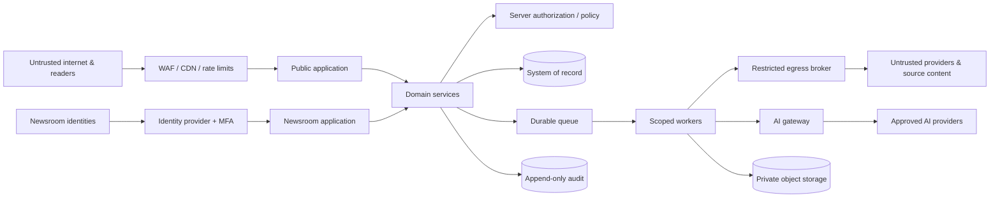

# Security Model

**Status:** Target threat model and production control baseline
**Last updated:** 2026-07-24

## 1. Scope and honesty

This model covers the public web application, newsroom, connectors, AI pipeline,
media, jobs, data, distribution, and revenue integrations. It describes
required controls; it does not certify that the reference frontend implements
them. Production launch requires evidence from
[SECURITY_TESTING.md](../SECURITY_TESTING.md).

External news content is hostile input. AI output is untrusted output.
Authenticated newsroom users may still be malicious or compromised.

## 2. Assets

- Published accuracy, corrections, and publisher trust.
- Unpublished drafts, embargoes, sources, legal notes, and editorial plans.
- Reader identity, preferences, consent, newsletter and notification data.
- Newsroom identities, sessions, roles, approvals, and audit records.
- Provider, database, storage, email, signing, and webhook secrets.
- Source snapshots and licensed media.
- Production availability, domain, feeds, search projections, and caches.
- AI prompts/policies, evaluation sets, model usage and cost budgets.
- Advertising campaigns, creatives, billing/reporting, and fraud signals.
- Backups and incident evidence.

## 3. Adversaries and failure modes

- Opportunistic web attackers and bots.
- A compromised reader or newsroom account.
- A malicious insider or over-privileged service principal.
- A source page designed to exploit parsers, fetchers, models, or editors.
- A manipulated trend campaign or coordinated misinformation operation.
- Malicious upload, embed, redirect, webhook, or spreadsheet export.
- Supply-chain compromise or leaked secret.
- Provider outage, account takeover, quota exhaustion, or data-policy change.
- Accidental editor error, unsafe bulk action, or configuration drift.

## 4. Trust boundaries

Every arrow crossing a boundary requires authentication where applicable,
authorization, schema validation, bounded size/time, logging, and a documented
data classification.

## 5. Threat/control matrix

| Threat | Required controls |
| --- | --- |
| IDOR / broken role authorization | Server-side object/scope checks, deny-by-default permissions, ownership from DB, negative integration tests |
| Account/session takeover | Phishing-resistant MFA where available, secure cookies, rotation, short privileged lifetime, revocation, reauth, anomaly alerting |
| Stored/reflected/DOM XSS | Structured content schema, contextual encoding, sanitization, CSP, no arbitrary script/embed HTML |
| CSRF | SameSite cookies, origin checks, anti-CSRF tokens for cookie-auth mutations |
| SSRF/DNS rebinding | Central egress broker, scheme/port/domain allow rules, resolve-and-pin public IP, redirect revalidation, time/size/type limits |
| Malicious upload/image bomb | Signed upload, magic-byte/type validation, size/pixel/decompression limits, malware scan, private quarantine, safe derivative |
| Prompt/tool injection | Trust separation, no source-granted tools, scoped context, schema validation, deterministic gates, adversarial tests |
| Webhook/cron forgery | Signed requests, timestamp/nonce, constant-time verify, replay store, rotation, network/rate policy |
| Queue replay/tamper | Authenticated queue, versioned envelope, idempotency key, lease, payload reference and integrity |
| Open redirect | Relative return-path allow rules, canonical destination validation |
| Secret leakage | Managed secrets, least privilege, no browser exposure, redaction, scanning, rotation |
| Data exfiltration in search/export | Visibility projection, permission filters, export limits, audit, CSV injection protection |
| Supply-chain compromise | Lockfile, trusted registries, review, SCA, provenance/SBOM where available, pinned CI actions |
| Editorial compromise | Separation of duties, immutable approvals/version hashes, sensitive human gate, kill switch, visible corrections |
| Trend manipulation | Multi-signal comparison, provenance, anomaly detection, editorial selection, no popularity-as-truth rule |
| Ad abuse | Creative scanning, redirect rules, label/placement controls, click replay/fraud monitoring, consent |

## 6. Authentication and authorization

- Production uses an approved identity provider; newsroom membership is stored
  and checked server-side.
- Sites/Sign in with ChatGPT identity headers, if used, establish identity only.
  Hosting access controls or explicit membership mapping must still authorize
  newsroom access.
- MFA is required for privileged roles where supported.
- Session cookies are `Secure`, `HttpOnly`, appropriately `SameSite`, scoped,
  rotated, and revocable.
- Authorization evaluates actor, tenant, object, section/ownership, state,
  field, and action on every path.
- Role changes revoke or refresh active sessions.
- High-impact actions require reauthentication and audit.
- Service principals use short-lived, task-scoped credentials and cannot inherit
  human role bundles.

See [permissions-matrix.md](../product/permissions-matrix.md).

## 7. Input, rendering, and browser controls

- Validate all parameters, JSON, forms, headers, cursors, IDs, dates, files, and
  provider payloads against centralized schemas.
- Store structured editorial blocks; sanitize any allowed rich text and render
  through safe components.
- Allowlist embed providers and construct embed URLs server-side.
- Apply a restrictive Content Security Policy, frame protections, MIME
  sniffing protection, referrer policy, permissions policy, and HSTS after
  domain readiness.
- Encode values in their HTML, attribute, URL, JSON, and CSV contexts.
- Reject spreadsheet formula prefixes or escape them safely in exports.
- Rate-limit sign-in, search, Ask This Story, newsletter, contact, upload,
  preview, and all mutations with actor/IP-aware controls.
- Error responses expose a correlation ID, not stack traces or secrets.

## 8. Safe fetching and source processing

Only the egress broker makes source requests.

1. Parse and canonicalize the URL.
2. Permit `https` (and explicit exceptional schemes only).
3. Apply host/port/provider allow policy.
4. Resolve DNS; reject loopback, private, link-local, multicast, metadata, and
   reserved ranges for every address family.
5. Pin the validated destination for the request.
6. Revalidate every redirect with a low redirect limit.
7. Bound connection/read time, bytes, decompressed bytes, and content type.
8. Do not forward cookies, authorization headers, or internal headers.
9. Parse in an isolated, patched process with scripts/macros disabled.
10. Store only permitted data and record retrieval/terms metadata.

Proxy endpoints and image optimization must not become arbitrary URL fetchers.

## 9. Media and object storage

- Uploads use short-lived signed policies restricted by owner, size, type, and
  key prefix.
- Originals enter a private quarantine bucket/prefix.
- Verify magic bytes, decode safely, enforce dimensions/pixels/frames, scan for
  malware, strip unsafe metadata as policy requires, and generate derivatives.
- Serve only approved derivatives from a separate public origin.
- Object keys are opaque; filenames are display metadata.
- Checksums detect duplicates/tampering.
- Storage policies enforce encryption, versioning where appropriate, lifecycle,
  and no public listing.
- License expiry can disable new use and alert editors without erasing
  historical audit evidence.

## 10. AI-specific controls

- Separate trusted instructions, application policy, tool results, source data,
  and user content.
- Models never receive secrets or unrestricted tools.
- Context is minimal, versioned, and source-delimited.
- Outputs are typed proposals; they cannot mutate approvals or publication
  directly.
- Prompt/model changes are evaluated and versioned.
- Sensitive data uses only approved providers/regions/retention terms.
- Detect unexpected secret-like strings, unsafe markup, source instructions,
  unsupported citations, and tool requests in outputs.
- Reader AI is rate-limited and restricted to public verified dossiers.

See [ai-agent-design.md](./ai-agent-design.md).

## 11. Jobs, webhooks, and automation

- Cron and webhook endpoints authenticate before parsing expensive bodies.
- Signatures cover timestamp, nonce/event ID, body, and relevant headers;
  reject stale/replayed events.
- Jobs use least-privilege queues, versioned schemas, idempotency, timeouts,
  leases, bounded retries, and DLQs.
- Publication locks/reloads state; an old approval or stale job cannot publish a
  changed version.
- Kill switches are server-side and audited.
- Bulk retry/replay runs in dry-run, scope, limit, and approval mode.

## 12. Data and privacy

- Encrypt transport and managed storage; use field-level protection for
  especially sensitive identifiers where justified.
- Separate public author profiles from authentication records.
- Minimize reader history, exact location, full IP, user-agent, and prompt data.
- Consent is purpose/vendor/policy-version specific and withdrawable.
- Exports/deletions verify identity and avoid disclosing other users or
  immutable editorial facts.
- Database roles separate application read/write, migrations, backup, analytics,
  and incident access.
- Production data is not copied to local/demo environments without approved
  de-identification.
- Backups are encrypted, access-logged, tested, and subject to retention.

## 13. Secrets and observability

- Secrets live in the deployment secret manager, never source or
  `.openai/hosting.json`.
- Use different secrets per environment and provider purpose.
- Rotate after suspected exposure and on provider policy.
- Logs are structured and redact tokens, cookies, authorization, email,
  private-source identities, raw prompts/source documents, and signed URLs.
- Audit records capture security-relevant decisions but avoid becoming a secret
  archive.
- Alerts cover auth anomalies, authorization denials, role/secret changes,
  publisher gate failures, source-fetch blocks, malware, webhook replay, queue
  backlog, unusual AI/ad cost, and logging/audit failure.

## 14. Supply chain and CI

- Lock dependencies and review updates.
- Run lint, type checks, unit/integration/E2E tests, SAST, dependency/license
  scan, secret scan, and build in CI.
- Pin third-party CI actions by immutable revision where the platform supports
  it.
- Restrict branch/deployment permissions and require review for security,
  authorization, publication, migration, and policy code.
- Generate artifact provenance/SBOM when supported; deploy the reviewed
  artifact, not an untracked rebuild.
- Keep build credentials short-lived and unable to read unrelated production
  data.

## 15. Security headers baseline

Finalize after all required third parties are inventoried:

- `Content-Security-Policy` with nonce/hash-based script policy and narrow
  `connect-src`, `img-src`, `media-src`, and `frame-src`;
- `Strict-Transport-Security` after HTTPS/domain validation;
- `X-Content-Type-Options: nosniff`;
- `Referrer-Policy: strict-origin-when-cross-origin` or stricter;
- `Permissions-Policy` denying unused capabilities;
- frame protection through CSP `frame-ancestors`;
- appropriate cross-origin resource/opener/embedder policies after compatibility
  tests.

Do not copy a header template without testing ads, embeds, images, identity, and
editor behavior.

## 16. Residual risks

Even with these controls:

- a credible source can be wrong;
- a model may produce persuasive unsupported text;
- an authorized editor can make an error;
- zero-day parser/browser/provider vulnerabilities remain possible;
- trend manipulation can evade detection;
- a third-party embed can change behavior;
- stolen newsroom sessions may act before revocation;
- availability depends on infrastructure and vendors.

Human review, multiple sources, least privilege, monitoring, kill switches,
corrections, and incident response reduce rather than eliminate risk. Never
describe the platform as 100% secure.

## 17. Launch-blocking evidence

- Server-side RBAC/IDOR suite.
- Stored/reflected/DOM XSS and sanitizer tests.
- SSRF/DNS rebinding/redirect/size/type test corpus.
- Malicious upload and image-bomb tests.
- Prompt/tool injection evaluation.
- CSRF, open redirect, webhook replay, cron authentication, queue replay,
  rate-limit bypass, secret leakage, CSV injection, and dependency scans.
- Backup restore and incident tabletop.
- Documented unresolved risks with owners and launch decisions.
