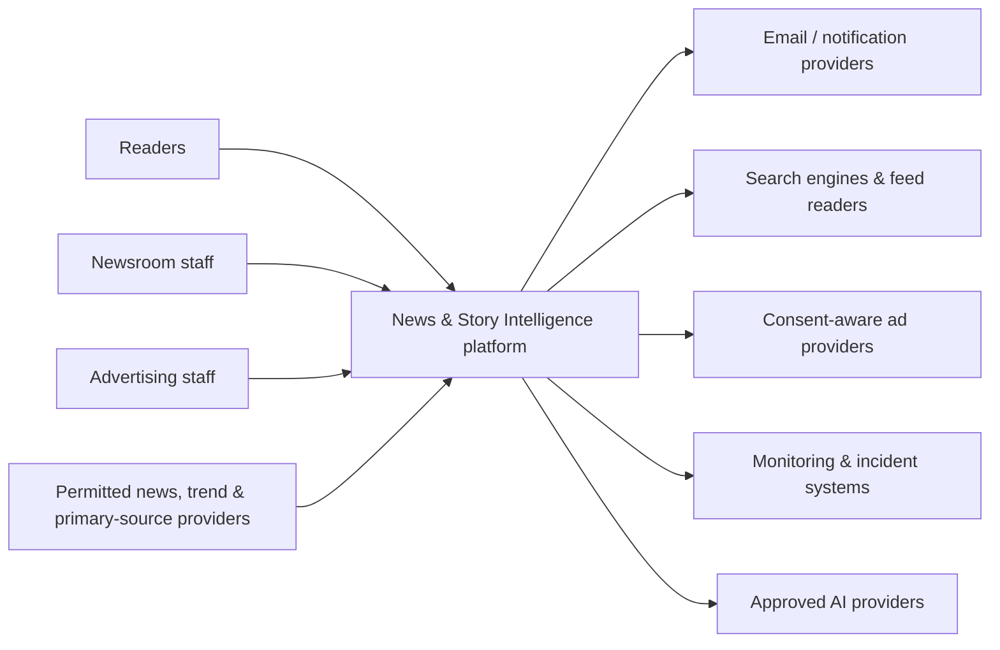
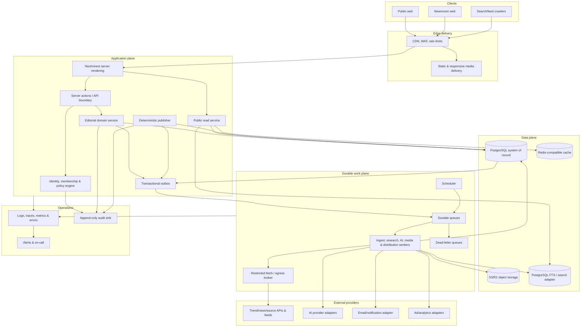

# System Architecture

**Status:** Target production architecture with an explicit reference-milestone
baseline
**Last updated:** 2026-07-24

## 1. Current-state baseline

At the time this architecture was authored, the repository started from a
vinext/Next.js Cloudflare worker template:

| Area | Current baseline | Production implication |
| --- | --- | --- |
| Web | Next.js App Router through vinext | Suitable for a server-rendered reference UI; validate every used Next feature in the target runtime. |
| Runtime | Cloudflare Worker entry point | Keep edge request work bounded; long-running work belongs in durable workers. |
| Data | Drizzle D1 adapter; schema initially empty | Demo/reference data is not a production newsroom database. |
| Bindings | `.openai/hosting.json` initially has `d1: null`, `r2: null` | No persistent D1 or R2 behavior should be claimed until bindings exist and are tested. |
| Identity | Optional Sites/Sign in with ChatGPT header helper | Establishes identity only; it is not newsroom membership or RBAC. |
| Queue/cache/search/AI/email | Not connected in the baseline | The interfaces below are contracts, not live services. |

The first milestone can implement a cohesive frontend and typed repository
boundary with fictional demo data. Production ingestion, publication, durable
state, and distribution require the later services and gates below.

## 2. Architectural principles

1. **Human accountability:** machines propose; policy and authorized humans
   control sensitive publication.
2. **Evidence before prose:** sources, snapshots, claims, and contradictions are
   first-class records.
3. **Canonical event model:** Story Clusters organize evolving events and reduce
   duplicate coverage.
4. **Ports and adapters:** providers, storage, search, AI, mail, analytics, and
   ad systems are replaceable integrations.
5. **Durable asynchronous work:** ingestion and AI stages do not run inside
   reader requests.
6. **Deny by default:** permissions, egress, publication, embeds, and media use
   require explicit allow decisions.
7. **Immutable publication:** published versions, approvals, snapshots, and
   audit evidence are append-only.
8. **Graceful degradation:** a failed connector, AI provider, personalization
   service, or ad vendor does not take down article reading.
9. **Observable costs and decisions:** every score, job, model call, transition,
   and publication gate is explainable.
10. **No false readiness:** UI demonstrations and interface contracts are not
    described as operating production services.

## 3. System context

External providers are untrusted and independently degradable. The platform
stores their contract, allowed use, attribution, caching rules, and health.

## 4. Target component architecture

### Why PostgreSQL is the production system of record

The newsroom domain requires transactions, constraints, many-to-many
relationships, immutable versioning, full-text search, JSON for bounded
provider metadata, and operational reporting. PostgreSQL is the target
architecture. The starter's D1/SQLite path may remain useful for a small
reference deployment, but adopting it for the complete production model
requires a separate capacity, consistency, migration, and query review.

The application accesses data through repositories so a reference adapter
cannot leak SQLite-specific behavior into domain services.

## 5. Application boundaries

| Boundary | Responsibility | Must not do |
| --- | --- | --- |
| Public read service | Resolve published canonicals, feeds, topics, search projections | Expose drafts or legal/private fields |
| Editorial service | Validate commands and state transitions in transactions | Trust client roles or mutate published versions |
| Policy/authorization engine | Evaluate actor, object, state, scope, and field permissions | Infer permission from UI visibility |
| Publisher | Publish the exact approved version after deterministic gates | Draft, browse, or waive a hard block |
| Connector adapters | Translate one permitted provider into normalized envelopes | Write articles or choose publication |
| Egress broker | Resolve/fetch allowlisted public resources under strict limits | Accept arbitrary redirects or private IP targets |
| AI gateway | Route bounded tasks, redact, meter, version prompts, validate outputs | Grant tools based on source text |
| Media service | Upload, scan, inspect, license, transform, and serve assets | Treat upload metadata as trusted |
| Search adapter | Index public projections and execute access-safe search | Become the source of record |
| Distribution workers | Reconcile sitemaps, feeds, mail, notifications, caches | Edit editorial copy |

## 6. Primary request flows

### Public article read

1. CDN applies WAF/rate policy and serves a fresh cached response when allowed.
2. The server resolves slug and redirect against the public projection.
3. The read service loads only a published immutable version and public related
   records.
4. Server rendering emits the full article, trust metadata, canonical, and
   structured data.
5. Nonessential personalization, analytics, audio, and ads enhance after the
   article remains usable.
6. Cache tags allow precise invalidation after publication or correction.

The read path does not call an AI model or third-party trend provider.

### Newsroom mutation

1. Identity is established by the production identity provider.
2. Server-side membership and session state are loaded.
3. Input is schema-validated and the target object is resolved from the
   database.
4. The policy engine evaluates permission, scope, state, and field.
5. A domain service performs the change in a transaction with optimistic
   concurrency where appropriate.
6. Audit and outbox records are committed with the change.
7. Workers process side effects idempotently.

### Publication

Publication locks the article, reloads the approved version, checks the version
hash, permissions, claims, evidence, risk, reviews, originality, rights,
metadata, embargo, daily caps, and automation policy, then atomically records
the published version and outbox events. Distribution is asynchronous and
reconcilable.

## 7. Data ownership and projections

- PostgreSQL owns editorial truth and workflow state.
- Object storage owns binary source snapshots and media; the database owns
  metadata and permissions.
- Search owns a rebuildable public index.
- Cache owns disposable derived values.
- Analytics owns aggregated behavior, not editorial source-of-truth records.
- Provider responses are retained only when contracts and policy allow.
- Public read models contain no draft body, private note, source embargo,
  personal data, or secret provider metadata.

## 8. Reliability model

- All provider work runs asynchronously with timeout, retry, jitter, rate-limit,
  and circuit-breaker policies.
- Jobs carry idempotency keys and expected input versions.
- Transactional outbox prevents a database commit from losing its downstream
  event.
- Dead-letter queues retain bounded failure metadata and references, not
  secrets or unnecessary source content.
- Publication and correction are available when AI, ads, analytics, or
  personalization are unavailable.
- Reader pages fall back to last-known safe published content during database
  incidents when cache policy permits.
- Kill switches exist for each connector, model, auto-publish, newsletters,
  notifications, ads, embeds, and personalization.

## 9. Performance strategy

| Area | Strategy |
| --- | --- |
| HTML | Server-render public editorial pages; cache published versions at CDN |
| JavaScript | Client components only for interaction; defer personalization and ads |
| Images | Rights-aware responsive derivatives, modern formats, dimensions, focal crop |
| Fonts | Subset/preload deliberately; avoid blocking third-party font calls |
| Database | Narrow selects, covering/partial indexes, cursor pagination, query budgets |
| Search | PostgreSQL FTS first; external adapter only after measured need |
| Feeds/sitemaps | Precomputed/reconciled projections, not expensive request-time joins |
| Ads | Reserved slots; lazy request; article remains stable when blocked |

Field targets for public editorial pages are LCP under 2.5 seconds, CLS under
0.1, and INP under 200 milliseconds at p75 where sample sizes make the
measurement meaningful.

## 10. Technology decisions

| Concern | Decision | Exit condition |
| --- | --- | --- |
| Web | Strict TypeScript, Next App Router semantics, vinext on Cloudflare for this repository | Move/adjust if runtime compatibility or workload limits fail |
| Styling | Tailwind plus an editorial component/token layer | No vendor-specific product logic in styles |
| Validation | Central schemas such as Zod at every boundary | Generated/API schemas may supplement |
| Data | PostgreSQL + Drizzle for production target | D1 only after explicit production fitness review |
| Cache/queue | Redis-compatible cache plus durable managed queue | Provider chosen per deployment SLO |
| Storage | S3-compatible or R2 with signed upload and private origins | Must support lifecycle, checksum, replication/backup needs |
| Search | PostgreSQL full-text initially | Typesense, Meilisearch, or OpenSearch when measured scale/relevance requires |
| AI | Provider-neutral gateway | No single provider types in domain models |
| Observability | Structured logs, traces, metrics, error tracking, uptime | Vendor-neutral correlation IDs |

## 11. Architecture fitness checks

- Domain code imports repository/provider interfaces, not vendor SDKs.
- Public requests make no synchronous connector or AI call.
- A connector failure cannot stop other connectors or article reads.
- A model output cannot directly invoke the Publisher.
- Published version updates require a new immutable row.
- Search and cache can be rebuilt from the system of record.
- Every high-impact mutation is authorization-tested and audited.
- Backup restore can rebuild public projections and resume queues safely.
- No UI or documentation calls a contracted service “live.”

## 12. Related documents

- [Data model](./data-model.md)
- [Job pipeline](./job-pipeline.md)
- [AI agent design](./ai-agent-design.md)
- [Security model](./security-model.md)
- [Deployment architecture](./deployment.md)
