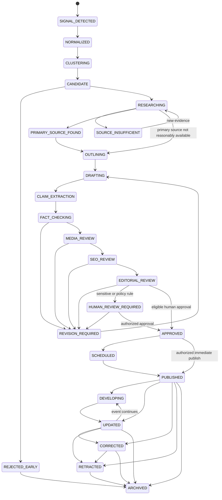

# Editorial Workflows

**Status:** Normative workflow contract
**Last updated:** 2026-07-24

## 1. Safety posture

The newsroom is human-accountable. AI can organize, extract, compare, and draft,
but it cannot create evidence or waive policy. Sensitive content always
requires human approval. Auto-publication is disabled until all launch gates
and the narrow low-risk enablement procedure are complete.

Every material action records actor, role, previous state, next state, reason,
timestamp, object/version, request or job ID, and policy result.

## 2. Canonical state machine

`PRIMARY_SOURCE_FOUND` records a useful event, not a universal prerequisite:
some legitimate stories have no obtainable primary source. In that case the
editor records why, requires sufficient independent high-quality evidence, and
continues from `RESEARCHING`.

## 3. Transition guards

| Transition | Minimum guard |
| --- | --- |
| `CLUSTERING → CANDIDATE` | U.S. relevance, novelty, and existing-cluster result recorded |
| `CANDIDATE → RESEARCHING` | Assignable angle, source path, risk pre-classification |
| `RESEARCHING → OUTLINING` | Dossier has sufficient independent evidence or an editor-approved exception note |
| `DRAFTING → CLAIM_EXTRACTION` | Draft references dossier only; author/agent and prompt version recorded |
| `CLAIM_EXTRACTION → FACT_CHECKING` | Central claims identified and evidence links present |
| `FACT_CHECKING → MEDIA_REVIEW` | No false or unsupported central claim; conflicts accurately framed |
| `MEDIA_REVIEW → SEO_REVIEW` | Every used asset has verified permission/attribution or approved removal |
| `SEO_REVIEW → EDITORIAL_REVIEW` | Canonical, metadata, headline, dates, and structured-data checks pass |
| `EDITORIAL_REVIEW → APPROVED` | Quality threshold met, original value ≥2, permissions and all hard gates pass |
| `HUMAN_REVIEW_REQUIRED → APPROVED` | Authorized human records an affirmative, version-specific decision |
| `APPROVED → PUBLISHED` | Approved version hash matches, schedule/embargo valid, publication transaction succeeds |
| `PUBLISHED → UPDATED` | Material new information; new immutable version and update note |
| `PUBLISHED/UPDATED → CORRECTED` | Error assessment, corrected version, visible note proportional to error |
| `* → RETRACTED` | Editor-in-Chief or delegated emergency authority; preserved notice and audit |

Quality scores cannot satisfy a missing hard guard.

## 4. Discovery and candidate selection

1. Connectors ingest permitted signals on their own schedules.
2. The normalizer retains raw provenance and produces normalized terms,
   geography, category, entities, and time windows.
3. Clustering links signals to an existing Trend Cluster and Story Cluster where
   appropriate.
4. Deterministic and model-assisted scoring produces component scores and
   explanations.
5. The Trend Scout recommends candidates but cannot create articles.
6. An editor merges duplicates, rejects noise, changes priority with a reason,
   or starts research.

Early rejection reasons include duplicate, weak U.S. relevance, no source path,
no original value, manipulated/noisy signal, excessive risk, rights issue,
stale event, or resource constraint. Rejection is reversible and auditable.

## 5. Research and evidence

The Research Agent or reporter:

1. searches only permitted sources;
2. identifies the earliest credible report;
3. prefers primary records;
4. collects multiple independent sources;
5. records snapshots only where lawful;
6. creates notes with source and retrieval timestamps;
7. marks missing facts and source conflicts; and
8. separates sourced fact, source allegation, analysis, and editorial
   observation.

The Claim Analyst converts the dossier into atomic claims. Each meaningful claim
contains section, category, supporting/contradicting evidence, primary-source
availability, timestamp, verification state, risk, reviewer, and notes.

Valid verification states are:

- `VERIFIED`
- `VERIFIED_BY_PRIMARY_SOURCE`
- `PARTIALLY_VERIFIED`
- `CONFLICTING_REPORTS`
- `UNVERIFIED`
- `OUTDATED`
- `FALSE`

Social and user-generated content remains a lead unless independently verified.

## 6. Planning, drafting, and editing

The Editorial Planner selects the reader intent, original angle, format,
required context, and missing research. The plan names at least two
original-value elements.

The Drafting Agent receives only the approved research packet and plan. It has
no independent browsing or publishing permission. A writer can draft manually
under the same evidence rules.

AI editor commands:

- operate on an explicit selection or section;
- receive the verified evidence subset needed for that operation;
- return a proposed diff;
- identify the model and prompt version;
- never silently commit;
- run claim support and policy validation after acceptance.

Copy editing improves clarity, American English, structure, neutrality, and
headline accuracy without changing facts silently.

## 7. Independent review sequence

Review independence means the fact-check stage does not treat the drafting
output as evidence and uses a distinct execution context.

1. **Fact review:** claim/evidence coverage, contradictions, dates, numbers,
   quotations, names, and central-claim status.
2. **Media review:** permission, relevance, manipulation, attribution, alt text,
   crop, resolution, expiry, and thumbnail safety.
3. **SEO review:** intent, canonical, metadata, structured data, internal links,
   dates, and image metadata; it cannot make the headline less accurate.
4. **Risk review:** required for a raised risk flag and all sensitive subjects.
5. **Editorial review:** news judgment, original value, completeness, tone,
   fairness, and final reader promise.

The same person may hold multiple roles in a small newsroom, but a sensitive
story cannot be written and finally approved by the same person. Emergency
exceptions require Editor-in-Chief approval and a retrospective review.

## 8. Sensitive-story routing

Any of the following sets `HUMAN_REVIEW_REQUIRED`: elections; government
leadership; war; military action; terrorism; crime; allegations; lawsuits;
deaths; missing persons; medical/public-health claims; investments/personal
finance; disasters; active emergencies; minors; sexual misconduct; identity
claims; leaked private information; graphic/traumatic events; or probable
reputational harm.

Rules:

- An AI risk result may raise risk but cannot lower a human-set classification.
- A high score never bypasses the route.
- Headline, hero media, push copy, social copy, and newsletter copy are included
  in the approval package.
- Material edits after approval invalidate that approval.
- Breaking urgency changes queue priority, not the evidence threshold.

## 9. Publication transaction

The Publisher is a deterministic service, not a creative agent. It:

1. reloads the approved immutable version;
2. evaluates server-side permission;
3. checks approval freshness and sensitive-story approvals;
4. confirms central claims, source count, original value, media decision,
   disclosure, canonical, structured data, schedule/embargo, and daily caps;
5. creates the published version and route atomically;
6. emits index, cache, feed, notification, and monitoring events; and
7. records a complete audit entry.

If any side effect fails after the publication transaction, the article remains
published and reconciliation jobs retry safe distribution tasks. A failure must
not duplicate notifications or versions.

## 10. Developing stories and live blogs

- A developing status names the last confirmed development and timestamp.
- Monitoring jobs may propose an update but cannot overwrite published copy.
- Each live entry is independently attributable, timestamped, sourced, and
  verified.
- Corrections to a live entry preserve the original version and show a note.
- The editor closes the live blog explicitly; inactivity does not imply closure.
- Scheduled refreshes cannot fabricate update timestamps.

## 11. Corrections, retractions, and removals

See [CORRECTIONS_POLICY.md](../CORRECTIONS_POLICY.md) for reader-facing policy.
Operationally:

1. log the report and preserve evidence;
2. triage severity and active harm;
3. freeze related automated distribution if necessary;
4. investigate against the exact published version;
5. approve a corrected immutable version;
6. publish a clear, proportional note;
7. update structured data, feeds, caches, and downstream messages where
   possible; and
8. complete a retrospective for severe errors.

Retractions retain the canonical URL and explain the action unless legal,
privacy, or safety review requires restricted text or a `410`.

## 12. Newsletter workflow

AI can assemble a draft from approved published versions. An editor verifies
selection, headline, summary, links, sponsorship label, audience segment, send
time, and consent query. Breaking or sensitive newsletters require human
preview and send approval. Send jobs use idempotency keys; unsubscribes and
suppression lists are checked immediately before delivery.

## 13. Sponsored-content workflow

The Advertising Manager creates a campaign and uploads rights-cleared creative.
Editorial policy review confirms labels, placement, claims, conflicts, and
audience safety. Commercial approval never grants `article.publish`.
Sponsored-article production uses a distinct content type, template, byline,
disclosure, and reporting chain.

## 14. Service objectives

These are operational targets after the relevant services exist:

| Workflow | Target |
| --- | --- |
| High-priority signal visible to Trend Desk | 15 minutes from successful connector ingest |
| Failed critical publication side effect detected | 5 minutes |
| Reader correction report acknowledged | 1 business day |
| Critical factual error triaged | 30 minutes during staffed coverage |
| Retraction/security emergency escalation | Immediate on-call page |
| Dead-letter queue triage | Same staffed shift for publication/distribution jobs |

Targets do not justify premature publication.

## 15. Related documents

- [Permissions matrix](./permissions-matrix.md)
- [Job pipeline](../architecture/job-pipeline.md)
- [AI agent design](../architecture/ai-agent-design.md)
- [Source policy](../SOURCE_POLICY.md)
- [Corrections policy](../CORRECTIONS_POLICY.md)
