# Information Architecture

**Status:** Target navigation and content contract
**Last updated:** 2026-07-24

## 1. Organizing model

The information architecture separates four concepts:

1. **Event:** the real-world occurrence, represented by a canonical Story
   Cluster and Story Intelligence page.
2. **Coverage:** individual articles, explainers, live blogs, visuals, and
   videos connected to that event.
3. **Subject:** durable topics and entities such as people, companies, teams,
   organizations, and locations.
4. **Signal:** evidence that audience interest or news activity is changing.
   Signals are newsroom inputs, not public facts.

This prevents repetitive event pages, supports durable topic authority, and
keeps trend popularity separate from verification.

## 2. Public sitemap

```mermaid
flowchart TD
    Home["Home /"] --> Discovery["Discovery"]
    Home --> Coverage["Coverage"]
    Home --> Subjects["Subjects"]
    Home --> Reader["Reader"]
    Home --> Trust["Trust & company"]

    Discovery --> Latest["/latest"]
    Discovery --> Trending["/trending"]
    Discovery --> LiveIndex["/live"]
    Discovery --> Search["/search"]
    Discovery --> Topics["/topics"]

    Coverage --> Story["/story/[slug]"]
    Coverage --> News["/news/[category]/[slug]"]
    Coverage --> Explainer["/explainers/[slug]"]
    Coverage --> Live["/live/[slug]"]
    Coverage --> Visual["/visuals/[slug]"]
    Coverage --> Video["/video/[slug]"]

    Subjects --> Topic["/topics/[slug]"]
    Subjects --> Person["/people/[slug]"]
    Subjects --> Company["/companies/[slug]"]
    Subjects --> Team["/teams/[slug]"]
    Subjects --> Source["/sources/[slug]"]
    Subjects --> Author["/authors/[slug]"]

    Reader --> Newsletter["/newsletter"]
    Reader --> NewsletterArchive["/newsletters/[slug]"]
    Reader --> Saved["/saved"]
    Reader --> Following["/following"]
    Reader --> Account["/account"]

    Trust --> About["/about"]
    Trust --> Contact["/contact"]
    Trust --> Standards["/editorial-standards"]
    Trust --> AI["/ai-policy"]
    Trust --> Corrections["/corrections"]
    Trust --> Ownership["/ownership"]
    Trust --> Funding["/funding"]
    Trust --> Advertise["/advertise"]
    Trust --> Sponsored["/sponsored-content-policy"]
    Trust --> Privacy["/privacy"]
    Trust --> Cookies["/cookies"]
    Trust --> Terms["/terms"]
```

Custom system surfaces are `/404`, `/410`, `/500`, `/maintenance`, and an
offline fallback. Framework-specific error routes may implement these URLs.
Their HTTP semantics are part of the contract: a missing resource returns 404,
an intentionally removed resource returns 410, and rendering friendly copy with
HTTP 200 is not sufficient.

## 3. Primary navigation

### Utility layer

- Latest
- Live
- Newsletters
- Search
- Account or sign-in
- Date/time and edition where useful

### Main section navigation

- U.S.
- Technology & AI
- Business
- Entertainment
- Sports
- Gaming
- Science
- Culture & Internet
- World for U.S. readers

Politics, elections, health, disasters, and other sensitive subjects can be
prominent when newsworthy but do not need a permanent top-level slot at every
viewport.

### Footer

The footer exposes publisher identity, contact, editorial standards, AI policy,
source policy, corrections, ownership/funding, media rights, privacy/cookies,
terms, advertising and sponsored-content policy, accessibility contact, feeds,
and newsletter controls.

## 4. Homepage hierarchy

The page is a curated publication followed by a real-time feed, not a grid of
equivalent cards.

1. Utility bar, brand header, sections, search, and personalization.
2. Conditional breaking banner.
3. One primary lead and a small secondary package.
4. Curated Top Stories.
5. Uninterrupted Latest feed.
6. U.S. Trending and “Why this is trending.”
7. Live and Developing.
8. Story Collections.
9. Most Read and, only when moderation exists, Most Discussed.
10. Section packages.
11. Newsletter conversion.
12. Clearly labeled sponsor placement.
13. Trust footer.

The first-screen briefing should feel finite: a reader can reach an orientation
and continue by choice. Infinite-scroll mechanics must not erase the boundary
between the curated briefing and deeper discovery.

### Feed contracts

- Top Stories are editor-curated and ranked.
- Latest is strictly reverse chronological by publication time.
- Pinned stories never interrupt Latest.
- The same canonical story is deduplicated within a feed response.
- A materially new article within a Story Cluster may appear once with an
  explicit relationship label.
- Previously read stories may be visually de-emphasized, never hidden.
- Top Stories remain non-personalized and public-interest aware.

## 5. Homepage modes

| Mode | Primary change | Required guard |
| --- | --- | --- |
| `NORMAL_DAY` | Standard curated lead and Latest | Default |
| `BREAKING_NEWS` | Breaking banner and denser live/update package | Editor activation and expiry |
| `ELECTION_NIGHT` | Results/context module and live chronology | Human review, result-source rules |
| `MAJOR_SPORTS_EVENT` | Score/status and live package | Licensed/official data |
| `ENTERTAINMENT_EVENT` | Visual event package | Media rights review |
| `PRODUCT_LAUNCH` | Specs, official video, and live updates | Sponsor separation |
| `NATURAL_DISASTER` | Safety information and live updates | Human review and official sources |
| `LOW_NEWS_DAY` | Fewer, deeper stories and evergreen collections | No filler |

Modes are versioned editorial configuration with author, activation time,
expiry, and audit record. A mode never changes verification rules.

## 6. Page anatomy

### Story Intelligence

Order the page for progressive disclosure:

1. Event identity, current status, follow control.
2. Plain-English summary and latest confirmed development.
3. Key facts, why it matters, and why it is trending.
4. Timeline and involved entities.
5. Confirmed, disputed, and unknown claims.
6. Primary documents and supporting sources.
7. Source-coverage comparison.
8. Permitted media, geographic context, and official embeds.
9. Related questions and Ask This Story.
10. What may happen next.
11. Connected coverage, update history, and corrections.

### Standard article

1. Category and status.
2. Headline and subheadline.
3. Byline/reviewer, publish/modified times, reading time.
4. Verification and AI-assistance disclosures where applicable.
5. Key takeaways and hero media with attribution.
6. Server-rendered article body with inline citations.
7. Context modules, timeline, quotations, video, or documents.
8. Source list.
9. Update history/correction notice.
10. Related coverage and follow/save/listen controls.
11. Newsletter conversion and reserved, labeled ads.

The first ad cannot visually separate the headline from the factual lead.
When enabled, labels such as `SYNTHESIS`, `ANALYSIS`, `OPINION`, `REVIEW`, or
`SPONSORED` appear before click and on the page; visual styling cannot make one
format impersonate another.

### Trending

Trend cards show the normalized term, plain-language explanation, trend
direction, approximate geography/time window, trigger, connected Story
Intelligence page, and a clear confidence/uncertainty note. Internal scores and
commercial value are not exposed as editorial truth.

### Search

Search supports query correction, content type, date, topic, entity, and source
filters. Results show date, format, status, and snippet. Empty states offer
related topics and Latest; they never generate thin indexable pages.

### Topic and entity pages

Each page has a durable description, latest coverage, active Story Clusters,
explainers, follows, and related entities. Pages without sufficient editorial
value are noindexed or not created.

### Following and briefings

Following prioritizes verified material changes. Each returning-story item says
what changed since the reader's last seen version and links to the supporting
evidence. A daily briefing is finite, explains why an item appears, supports
cadence/quiet-hour controls, and always retains a small newsroom-selected
essential-news layer.

## 7. Newsroom sitemap

The logical newsroom may live under `/newsroom`; deployment can place it behind
a separate host without changing its domain model.

```mermaid
flowchart TD
    Dashboard["/newsroom"] --> Trends["/newsroom/trends"]
    Dashboard --> Research["/newsroom/research"]
    Dashboard --> Articles["/newsroom/articles"]
    Dashboard --> Review["/newsroom/review"]
    Dashboard --> Schedule["/newsroom/schedule"]
    Dashboard --> Published["/newsroom/published"]
    Dashboard --> Corrections["/newsroom/corrections"]
    Dashboard --> Sources["/newsroom/sources"]
    Dashboard --> Media["/newsroom/media"]
    Dashboard --> Live["/newsroom/live"]
    Dashboard --> Newsletters["/newsroom/newsletters"]
    Dashboard --> Revenue["/newsroom/revenue"]
    Dashboard --> Operations["/newsroom/operations"]
    Dashboard --> Settings["/newsroom/settings"]

    Trends --> Candidate["Candidate detail"]
    Research --> Dossier["Research dossier"]
    Articles --> Editor["Block editor"]
    Review --> Workspace["Review workspace"]
    Operations --> Jobs["Jobs & dead letters"]
    Operations --> Health["Connector health"]
    Operations --> Costs["AI/API costs"]
```

Authorization applies to every loader, query, action, and mutation. Navigation
visibility is only a usability aid.

## 8. Taxonomy and relationships

### Controlled categories

Categories are a small, editorially governed set. Tags describe transient
attributes. Topics are durable editorial subjects. Entities are canonical
people, organizations, companies, teams, products, or locations.

Rules:

- An article has one primary category and may have secondary topics.
- A slug change creates a permanent redirect.
- Entity aliases resolve to one canonical entity.
- Trend terms never automatically create public topic pages.
- Story Clusters can relate as predecessor, consequence, comparison,
  correction, or background.
- Sponsored material cannot become a source of editorial authority merely
  because it shares taxonomy.

## 9. URL and canonical rules

- URLs are lowercase, human-readable, stable, and omit dates unless the format
  requires them.
- One public object has one canonical URL.
- Query/filter URLs are noindexed unless intentionally curated.
- Retractions normally retain the URL with a notice; legal removal uses `410`
  only after authorized review.
- Merged stories redirect to the surviving canonical Story Cluster.
- Pagination uses stable cursors internally and crawlable links only where
  indexation is useful.
- Locale defaults to U.S. English; future editions must not silently change the
  canonical audience.

## 10. Findability and accessibility

- Heading order mirrors the information hierarchy.
- Landmark regions label navigation, main content, complementary material, and
  footer.
- Skip links reach the article or primary feed.
- Keyboard focus follows visual order and remains visible.
- Filters and tabs expose selected state programmatically.
- Live updates do not steal focus and use restrained announcements.
- Timestamps include machine-readable values and visible U.S. timezone labels.
- Status never depends only on color, animation, or iconography.
- Search, feed, and block-editor interfaces work at 200% zoom and narrow
  viewports.

## 11. Content ownership

| Surface | Accountable owner |
| --- | --- |
| Homepage hierarchy and modes | Managing Editor |
| Story Intelligence | Assigned News or Section Editor |
| Article facts and wording | Writer plus approving editor |
| Claims/evidence | Fact Checker |
| Source records | News Editor or source administrator |
| Media rights | Media Editor |
| SEO metadata | SEO Editor; headline remains editorial |
| Sponsored surfaces | Advertising Manager with editorial policy review |
| Trust/policy pages | Editor-in-Chief with legal/security owners as applicable |

## 12. Related documents

- [Product requirements](./product-requirements.md)
- [Editorial workflows](./editorial-workflows.md)
- [SEO policy](../SEO.md)
- [Data model](../architecture/data-model.md)
